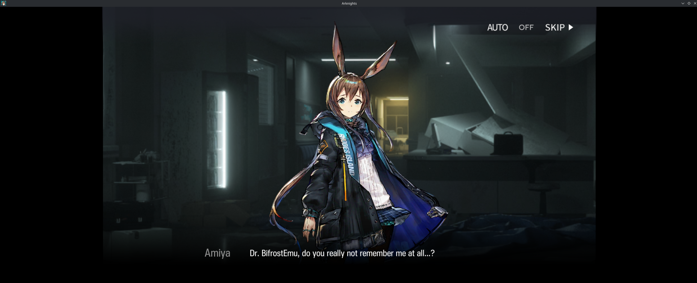

# Arknights

Global package: `com.YoStarEN.Arknights` (tested version 37.7.41, installed from its APKMirror `.apkm` bundle).
Status: **playable**, from the user's report on November 3, 2026, on Bifrost 2.0.0-beta.1: Google sign-in through microG
works, a battle ran at about 60 FPS with nothing obviously wrong, and a capture shows the opening story scene. The game
ran through the globally installed `bifrost-emu`.

## Installing

```sh
bifrost-emu com.YoStarEN.Arknights_37.7.41-2000194_..._apkmirror.com.apkm
```

The bundle carries a base APK, `arm64-v8a` and `armeabi-v7a` config splits and two Unity asset packs. The data asset
pack alone is 1,024.1 MiB and the APKs unpack to 2.27 GiB, so installing it needs commit `1d61c57a`: before it, Asgard
refused nested APKs over 1 GiB and APK sets over 2 GiB uncompressed.

## What is established

- User-reported: install, microG sign-in and a battle at about 60 FPS, with no problems noticed (2026-11-03).
- Not recorded: frame-time logs, audio, long sessions, pause/resume, and how far past the first battle the game works.
  The 60 FPS figure is the user's observation, not a measurement.

## Where host time goes (2026-11-04)

One session on the repo build at `1fd554ab` (the first with the all-thread sampler, `BIFROST_PROF=1`; report every 60 s, 100 Hz of CPU
time), on the maintainer's machine, about six minutes: loading, menus, then a battle the user played (the minute the user marked is one
of the last two). The sampler's reports are cumulative, so each row is the difference of two reports. 120 or more threads sampled, no
sample lost.

| Minute | Samples | In JIT code | Translating | Interpreter | Dispatch | Other | Entry / body / exit within JIT code |
|---|---|---|---|---|---|---|---|
| 1 (loading) | 7371 | 68.1% | 11.5% | 10.3% | 6.5% | 3.7% | 10.6 / 73.4 / 15.0 |
| 2 | 3181 | 72.8% | 3.6% | 8.4% | 8.8% | 6.4% | 14.7 / 69.9 / 14.7 |
| 3 | 3255 | 81.6% | 2.5% | 1.6% | 7.5% | 6.8% | 14.5 / 71.6 / 13.7 |
| 4 | 2604 | 77.5% | 1.2% | 3.5% | 8.5% | 9.3% | 18.5 / 67.4 / 14.0 |
| 5 | 3163 | 78.7% | 0.1% | 2.3% | 9.4% | 9.6% | 18.2 / 67.2 / 14.5 |
| 6 | 3043 | 78.4% | 0.7% | 2.6% | 10.2% | 8.1% | 15.1 / 71.3 / 13.1 |

After loading, translation and the interpreter are nearly gone and about 78% of CPU time is in translated code. Inside it, block
**entry** (loading the canonical register layout) and **exit** (publishing state) are together about 28% to 33%, the **body** about
70%, and cold code and the shared stubs under 1%. The twenty hottest guest blocks are almost all body (97% to 100%); the entry and
exit time is spread over many blocks, not concentrated in a few, and a few single blocks are mostly entry or mostly exit.
Dispatch is 7% to 10% of CPU and "other" (host libraries, syscalls) 6% to 10%.

What this does not show: one session of one game; sample counts are time, not instructions; the sections are rounded percentages of
cumulative counts, so small values can come out slightly negative (cold −0.5% in minute 4); no frame times, and the user did not mark
which minute was the battle more exactly than "one of the last two". It is not a measurement of how much a change to block entry
and exit would save: at most the entry and exit share (about a fifth of all CPU time here), and in practice less.

## Screenshots (2026-11-03)

User-supplied capture from Bifrost 2.0.0-beta.1. The opening story scene, with the player's chosen name in Amiya's line
("Dr. BifrostEmu"); the black bars at the sides are the window outside the game's 16:9 area:


