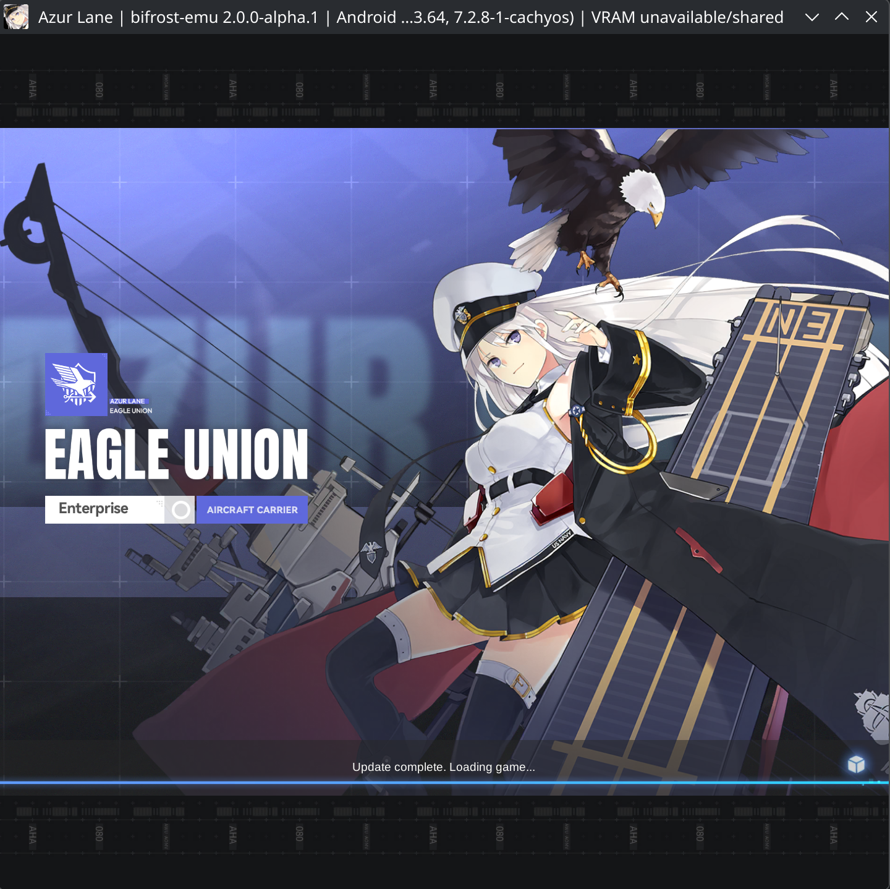
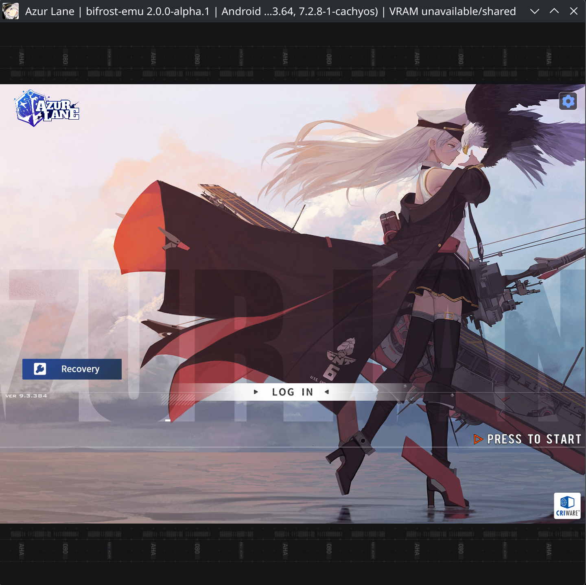

# Azur Lane

Package: `com.YoStarEN.AzurLane` (installed package version 9.3.7).
The October 14, 2026 user-supplied screenshots show loading and the title/login
screen on Bifrost 2.0.0-alpha.1. This advances the previous logged-screen
checkpoint to visible rendering evidence; gameplay and completed sign-in
remain unverified.

## Screenshots (2026-10-14)

Loading after the update check:

Title/login screen:

These still images do not measure frame pacing or prove working login,
WebView input, battle gameplay or long-session stability.

## Remaining work

- Reproduce and profile the user-reported UI stutters in the delayed login
  scene, including input/service, rendering, ART and JIT costs.
- Implement the toast lifecycle: an observed Google sign-in failure reaches
  unsupported `notification.enqueueToast` and can terminate the app.
- Complete attached WebView focus, pointer/scroll and text/IME interaction,
  external browser intents and supported callback/deep-link delivery.
- Validate successful entry into gameplay, audio, pause/resume, resize and
  a sustained interactive session before expanding the compatibility claim.

See the [runtime checkpoint](../Android/ANDROID_RUNTIME.md#azur-lane-interaction-checkpoint-2026-10-14),
[generated-code audit](../JIT.md#azur-lane-generated-code-audit-2026-10-14)
and [next-release priorities](../roadmap.md#next-release-priorities).
