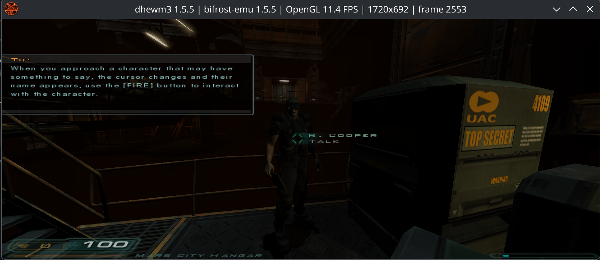
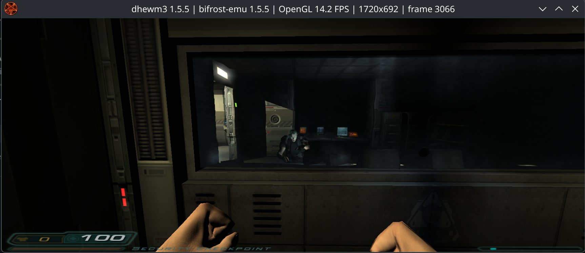

# Doom 3 (dhewm3)

The detailed investigation history (dated fixes, profiles, regressions) is in [the Doom 3 (dhewm3) history](../archive/apps/doom3-history.md).

## Current status (2026-10-11)

After the scalar JIT flag/guard optimizations and SSA integration, the user
reported a noticeable gameplay improvement, followed by intermittent freezes.
This is a live user observation, not a matched-scene benchmark. The freeze's
cause has not been localized and no SSA on/off comparison has been captured;
the JIT changes do not establish a stability fix. The measured CoreMark results,
SSA coverage and verification limits are recorded in [JIT.md](../archive/JIT-history.md#optimization-checkpoint-2026-10-11).

### Current frame rate report (2026-10-28)

The maintainer reports that the current build holds about 60 FPS through most of
the early game and runs demanding scenes at about 20–30 FPS. This is an
observation, not an instrumented frame-time series, and no resolution, host or
scene was recorded with it. It supersedes the October 5 figures below (mostly
25+ FPS, 1–5 FPS in the spider-robot encounter), which were taken on an older
build.

### Previous gameplay checkpoint (2026-10-05)

Use the default tier-1 JIT with MT chaining. Tier-2 is now opt-in via
`BIFROST_TIER2=1` after a reported gameplay slowdown with MT region promotion.
The live comparison logs showed higher reported throughput with tier-2 off,
but were not a matched-scene FPS benchmark. A renderer fault in a recent
new-game session remains unresolved; this default change is not a crash fix.

Default-JIT gameplay, character animation and audio work in the observed demo
sessions, including the user's approximately 27-minute crash-free recording.
The October 5 user report adds about 25 minutes of stable gameplay with the
other games initially running concurrently: mostly 25+ FPS, warm-up dips around
9–19 FPS and some stretches at 60 FPS. The spider-robot/enemy encounter drops
to 1–5 FPS. These are user observations, not an instrumented frame-time series.
New underground saves and a fresh save/load round trip restore successfully;
the older checksum-incompatible save is rejected by the game. Settings,
viewport/cursor behavior, gamepad coverage and demanding-scene frame pacing
remain open. Sustained 5 FPS at 3440×1440 is not yet established by a matched
benchmark.

The October 5 capture sampled 80.81% translated code, 13.30% dispatch/native
helpers, 0.034% translation, 0.004% interpreter and 5.85% other host work.
The cache grew once and had no overflow or budget fallback. This includes worker
CPU time and is not main-thread frame-time attribution or a controlled
before/after FPS comparison. See the [capture analysis](../archive/apps/doom3-history.md#concurrent-gameplay-capture-2026-10-05).

Current full-suite counts and their final-build coverage limits are in
[TESTS.md](../TESTS.md): 273/273 JIT and 266/266 interpreter with seven JIT-only
skips. The selected suite includes 95 unit definitions and the MT publication gates.
Older counts and timings below describe intermediate checkpoints.

## Local launch

```bash
./rootfs/dhewm3/run-bifrost.sh
```

The launcher uses the default JIT, a window, guest-relative data/save paths,
and a private library directory. Private Debian ARM64 runtimes supply
libcurl 7.88.1 (bookworm), its matching LDAP/LBER libraries, and librtmp;
other dependencies come from the existing guest rootfs. These binaries and
the demo data are ignored local assets, not repository source.

Sources: [official release](https://github.com/dhewm/dhewm3/releases/tag/1.5.5),
[demo installation/checksum](https://dhewm3.org/#using-the-doom3-demo-gamedata),
[Debian curl packages](https://deb.debian.org/debian/pool/main/c/curl/).

## Gameplay screenshots (2026-10-04)

User-supplied Mars City hangar and security-checkpoint screenshots show an NPC, interaction prompts, lighting and HUD rendering. Window stats report 1720×692 with instantaneous presentation samples of 11.4 and 14.2 FPS; these are not sustained benchmarks or proof of animation correctness.




