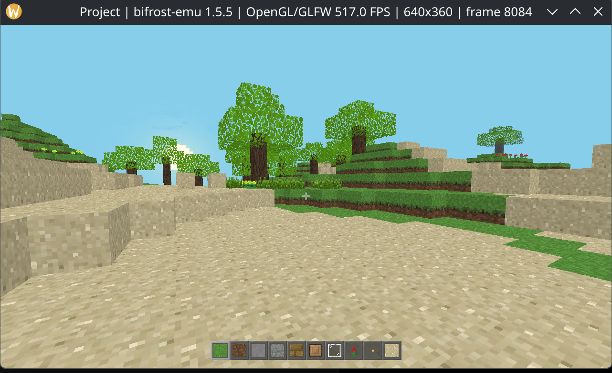
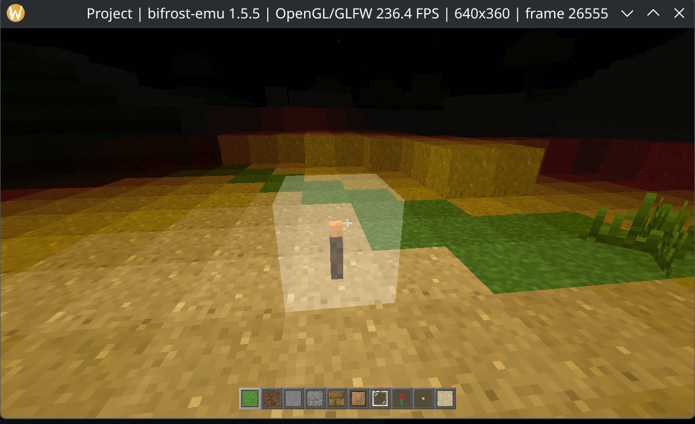

# Minecraft Weekend

## Current status (2026-10-03)

The user reports stable gameplay and reconfirmed that the game works after
launching with the repaired emulator. Chunk rendering can be laggy. The
suspected cost of guest allocation/brk activity has not been established by
this gameplay confirmation.

## Running

Run from the game directory so its resources resolve:

```sh
cd Tests/Apps/minecraft_weekend
../../bifrost-emu ./minecraft_weekend.elf
```

The locally built static ARM64 executable uses the GLFW/OpenGL thunk bridge.
Keep the `res/` directory with the executable. This is an interactive gameplay
checkpoint, rather than exhaustive validation of every world or input path.

## Gameplay checkpoint (2026-10-04)

User-supplied daytime gameplay shows terrain, trees and the hotbar. Window stats report an internal render size of 640×360. The FPS in the title is an instantaneous presentation sample, not a sustained benchmark.





## Profile (2026-11-16)

A 60 s `perf record` of the game standing in its world (no input; window open, one run each, cycles in user space):

| Where the CPU went | Before | After |
|---|---|---|
| Translated game code | 31.7% | 38.9% |
| `bifrost-emu` itself | 31.2% | 33.5% |
| host libc | 23.0% | 7.9% |
| graphics driver (Mesa) | 11.3% | 15.7% |

Before, 20% of all cycles were `strlen`, `memcmp` and `strcmp` from the graphics thunk comparing symbol names as strings on
every OpenGL call, and `GraphicThunk::dispatch` with those comparisons was about 39%. After replacing them with integer
ids the game drew 58,999 frames in the minute against 42,870 (the in-world clock was equal, 3,595 against 3,593 ticks) at
the same total CPU, which is 4.30 M cycles per frame against 5.95 M. Single runs: the world and its chunk loading are not
identical between runs. The hottest translated block in both profiles is `memset` in the chunk mesher (a 64-byte
`stp q0,q0` store loop, about 19% of the translated-code samples); `GraphicThunk::dispatch` is still 15% of the
cycles after the change.

