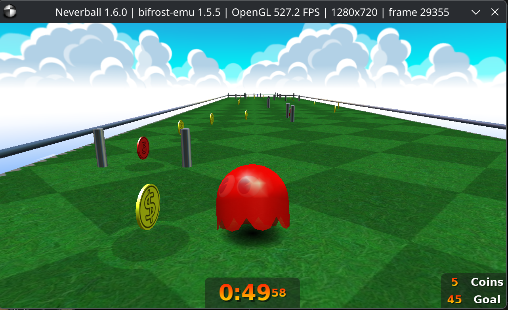
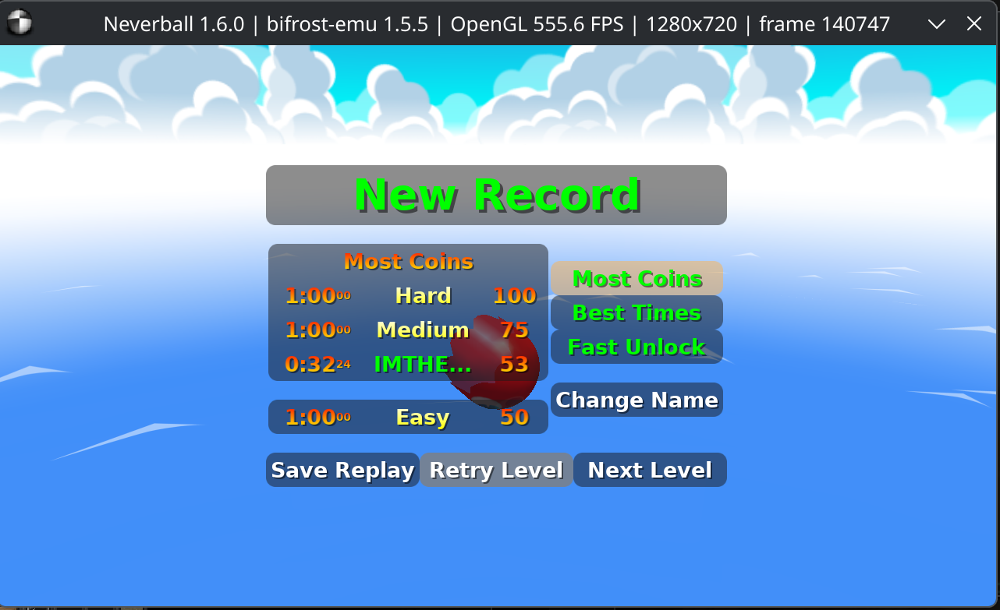

# Neverball

Latest user gameplay confirmation: October 3, 2026. No new issue was reported.
The dated repair/test results below are historical checkpoints; current
cross-project suite counts are maintained in [TESTS.md](../TESTS.md).

As of 2026-10-02, the user reports Neverball 1.6.0 is effectively fully stable
in interactive play on Bifrost. Gameplay, replay, fonts and menus, configuration
persistence, and level-preview rendering are working after the font, SDL,
JIT memory-guard, and JPEG decoding fixes below.

Earlier testing confirmed monitor and resolution selection, ball-model changes,
and player-name editing. The October 2 confirmation followed the JPEG repair and
relaunch. This is a user-reported stability milestone; automated checks cover
the underlying regressions and selected images, rather than every level or a
long-duration gameplay soak. The user also confirmed mouse control works in
fullscreen gameplay and after returning to windowed mode on 2026-10-02.

The user reconfirmed working gameplay on 2026-10-03 after relaunching with
the repaired interpreter decode cache. No new Neverball issue was reported.

The detailed investigation history (dated fixes, profiles, regressions) is in [the Neverball history](../archive/apps/neverball-history.md).

## Running

With the AArch64 game and its dependencies installed in `rootfs`:

```sh
make
BIFROST_ROOT="$PWD/rootfs" ./bifrost-emu rootfs/usr/games/neverball
```

A desktop display must be available. The font symlink under
`rootfs/usr/share/games/neverball/ttf` must resolve to a readable font in the
rootfs. This setup uses `DejaVuSans-Bold.ttf`. A missing target prevents a valid
font-enabled reproduction.

## Gameplay checkpoint (2026-10-04)

User-supplied gameplay shows the level, coins, HUD and selected ball model rendering at 1280×720. The FPS in the title is an instantaneous presentation sample, not a sustained benchmark.



The record screen is included too; it retains the player alias visible in the supplied image.


