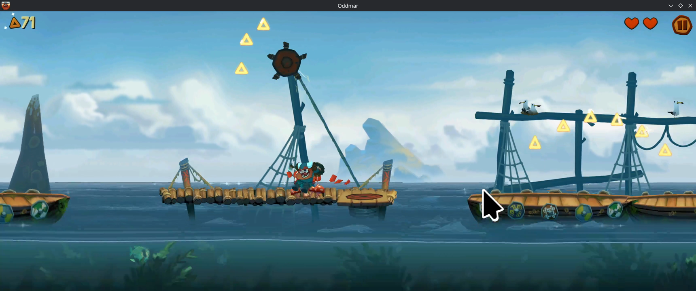
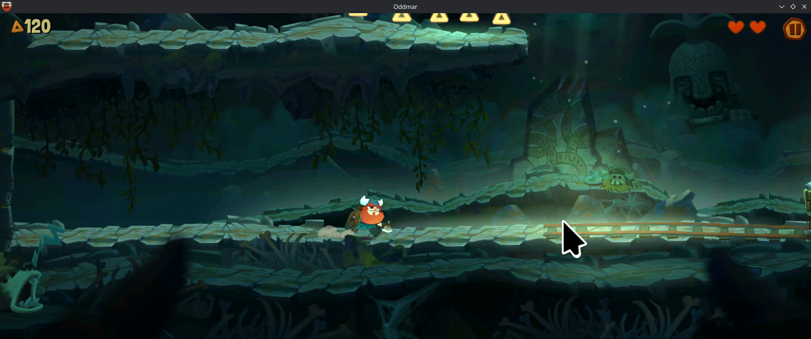
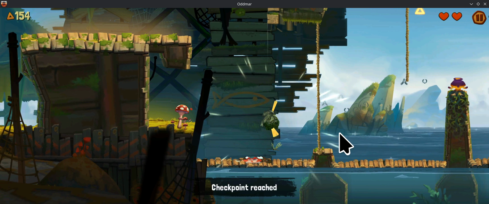

# Oddmar

Package: `com.mobge.Oddmar` (Unity 2018.4, IL2CPP).
Status: **playable**, from the user's report on November 8, 2026, on Bifrost 2.0.0-beta.1: the first level plays very well and no
stutter was noticed. A frame from the user's 4 minute screen recording at 3440x1440 shows level gameplay (below).

## Needs

The splash video opens through `media.extractor`, the media daemon uses POSIX timers, and the game ends with `env null. Attach
JVM?` without the Java Binder attach preload. All three are in the runtime (2026-11-01).

## What is established

- User-reported: the first level plays very well with no stutter noticed (2026-11-08). Frames from the recording at 1:04, 2:08
  and 3:12 each show gameplay with the HUD (triangle count, two hearts, pause button) and the character in a level, in three
  different places, so the recording is of play, not a menu or loading screen.
- Not recorded: frame-time logs or any measurement of smoothness (the frames above cannot show it), audio, later levels, long
  sessions, pause/resume.

## Screenshots (2026-11-08)

Frames from the user's screen recording on Bifrost 2.0.0-beta.1, scaled to half size. The cursor is the host's.

