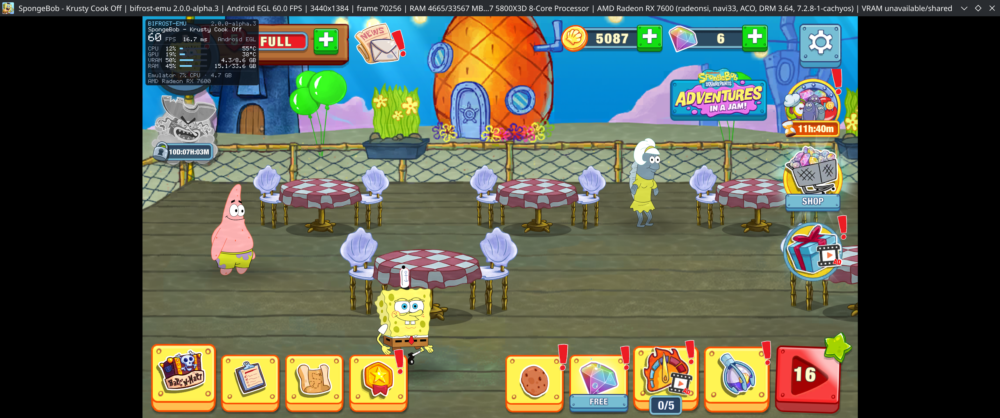
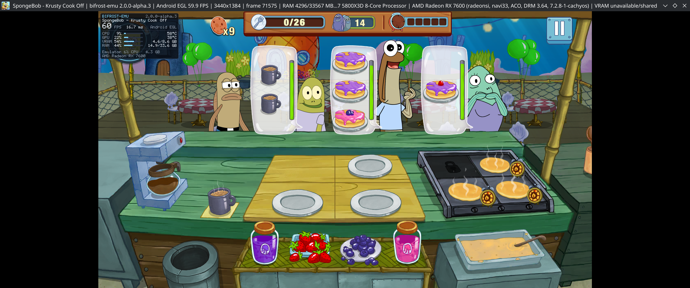
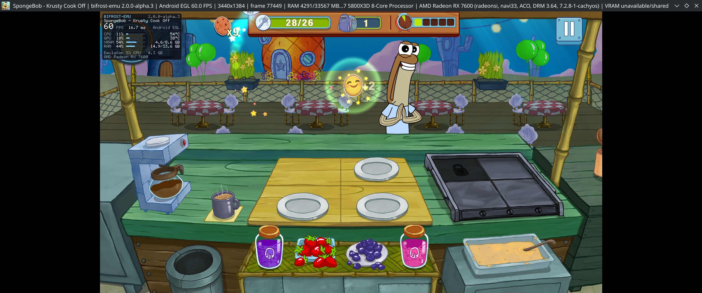
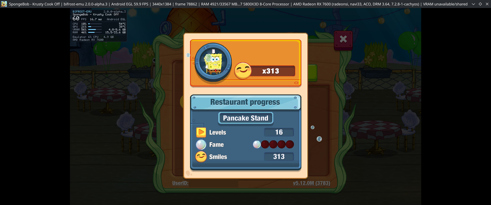
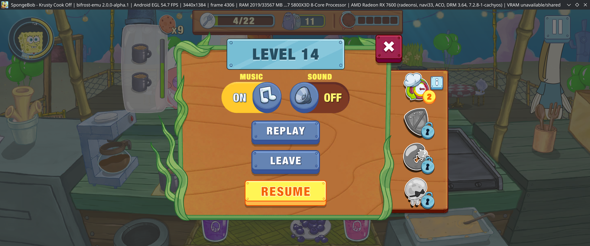
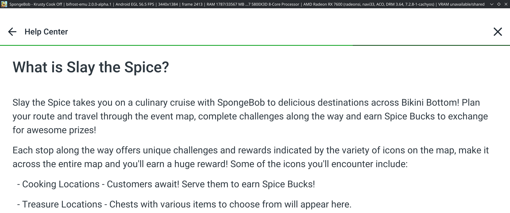

# SpongeBob - Krusty Cook-Off

Installed version: 5.12.0 (`com.tiltingpoint.spongebob`, pulled from the user's
phone). Runtime contracts and the bug history behind each checkpoint are in
[the Android runtime guide](../Android/ANDROID_RUNTIME.md).

As of 2026-11-01 the user plays cooking levels, reaching level 16, at about 60 FPS on 2.0.0-alpha.3. As of 2026-10-14
they complete levels, open Settings and Help Center, and the main HUD stays after closing Settings. Play renders
at the host display's native density (2560x1384 or 3440x1384 px, 320 dpi on a
200%-scaled 3440x1440 monitor). The child-age path is required: the adult path
stalled at 73% on Firebase/Google Play services.

On 2026-10-17 the `GoogleApiHandler` crash on `activity.getContentProvider`
was fixed by running microG in its own processes (see the runtime guide).
A 180 s JIT run on the saved child-age profile reached the Unity tracker
setup with GmsCore, its `:persistent` process and the Play Store companion
running, without a fatal exception or the earlier FirebaseInstanceId
"Google Play services missing" error. The adult-age path has not been
retested on this build.

## Screenshots (2026-11-01)

User-supplied captures from Bifrost 2.0.0-alpha.3, from the session that reached level 16. The titles report Android EGL
at 3440x1384 and the Radeon RX 7600 renderer. All four read about 60 FPS at 16.7 ms with the machine's CPU at 9-12% and
GPU at 18-22%. These are momentary readings, not a benchmark or a claim of sustained frame pacing.

| Time | Screen | FPS | RAM (title bar) | VRAM (whole machine) |
|---|---|---|---|---|
| 11:55:43 | Lobby | 60.0 | 4665 MB | 4.3 GB |
| 11:56:13 | Cooking, start of a level | 59.9 | 4296 MB | 4.6 GB |
| 11:57:54 | Cooking, end of a level | 60.0 | 4291 MB | 4.6 GB |
| 12:00:17 | Restaurant progress | 59.9 | 4921 MB | 4.8 GB |

The title bar's RAM is the whole session by PSS ([window stats](../window-stats.md)). No other game was running.

Lobby and progression HUD:

Cooking gameplay with customer orders:

End of a level, with the target passed:

Restaurant progress (the account's user ID is covered):

### Earlier screens (2026-10-14)

From Bifrost 2.0.0-alpha.1, for screens the newer set does not show.

Level-14 pause menu:

Help Center article rendered inside the game:

These images document visible gameplay and UI states. They do not establish
working rewarded ads, purchases, Google Play-dependent features or complete
WebView input. Upcoming compatibility, performance, ads and usability targets
are in the [next-release roadmap](../roadmap.md#next-release-priorities).

## Fixed: character drawn incompletely after equipping (2026-10-12)

Equipping an outfit made SpongeBob lose his sponge body, base and nose on the
outfit screen, the main screen's avatar portrait and the level platforms.
Equipping runs Spine-Unity's `AtlasUtilities.GetRepackedSkin` (called from the
game's `AvatarCustomizer`), a CPU-side repack through `Texture2D.GetPixels`,
`SetPixels`/`Apply` and `PackTextures`; no GPU texture copy is involved. A
fallback profile diffed across one equip (`BIFROST_FALLBACK_PROFILE` with
`%p`, per process) listed the instructions the repack interpreted. Run against
QEMU, vector `FCVTL` (half to single, `0x0E217800`) returned garbage: only the
single-to-double form was implemented. Related half-precision and NaN defects
were fixed with it; see [the JIT guide](../JIT.md#half-precision-conversions-and-arm-nan-results-2026-10-12).
The user confirmed the character, portrait and lobby draw correctly afterwards.
Native-density rendering was ruled out first with `BIFROST_ANDROID_LOGICAL_PIXELS=1`.

## Fixed: IL2CPP heap corruption crash (2026-10-13)

A session left on the 73% loading screen exited with status 191 after 87 s.
Threads 94/306/308/311 faulted in `libil2cpp.so` (identified by matching the
logged instruction bytes; the emulated `/proc/self/maps` has no file names):
a NULL class at `+0x135`, a garbage array allocation, and a Boehm free-list
link containing the text `mscorlib`. Two threads had allocated the same
object. The cause was a replayed STLR store releasing the GC allocation lock
held by another thread; see [the JIT guide](../JIT.md#guest-memory-barriers).
The crash is rare in the game (a 240 s unattended run did not reproduce it);
the guest fixtures reproduce it in most runs.

## Open issues

### Kidoz ad stuck on its loading screen (2026-10-13)

The One Piece rewarded ad (Kidoz, MRAID/VAST player in a WebView, stacked
Activity) shows its "SpongeBob x One Piece" loading screen with an empty
progress bar and never reaches the ad itself. Observed by the user in two
sessions, before and after the max-bounds fix:

- The loading screen draws in the upper-left part of the 3440x1384 window
  rather than filling it. The player reports `screenWidth 1720,
  screenHeight 720` (the 3440x1440 monitor in dp at 2x).
- Right after the player's `getParams` call, a guest thread does
  `unmapped read at 0x0` (thread 157, then thread 155); the game keeps
  running but the ad stays on its loading screen.
- The main thread skips 120-190 frames every 2-3 seconds while the ad is
  up (`Choreographer: Skipped N frames`).
- Before the max-bounds fix it also logged "too large to fit into a
  software layer ... only 0 available"; that warning is gone and nothing
  visible changed.

Next steps: find the faulting PC and library for the null read, then compare
the WebView's layout size with the Activity window. Logs:
`android-state/com.tiltingpoint.spongebob/managed/sessions/0766a3a30f904fcaa889e32cefc16b94/`.

### No mail/news (2026-10-12, uninvestigated)

The phone shows mail in the news envelope; Bifrost shows none. Likely a
failed news fetch or service gap; no log evidence collected yet.
