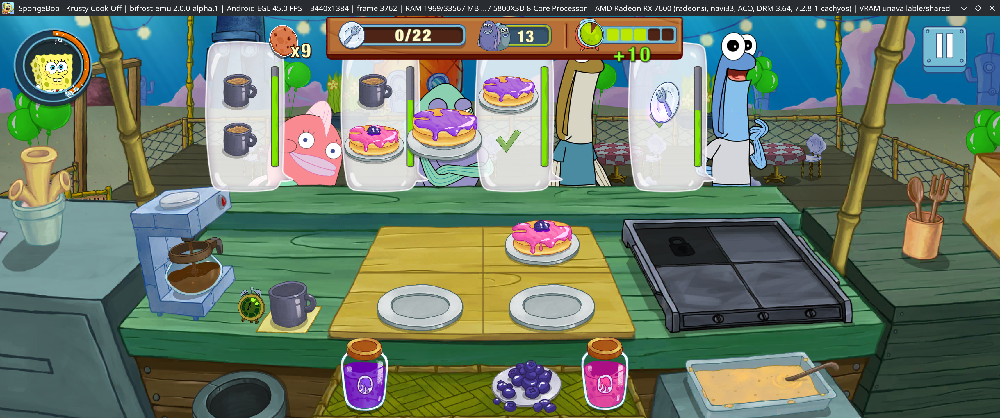
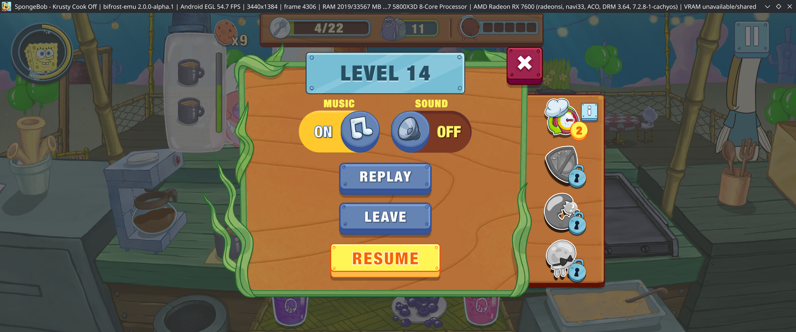
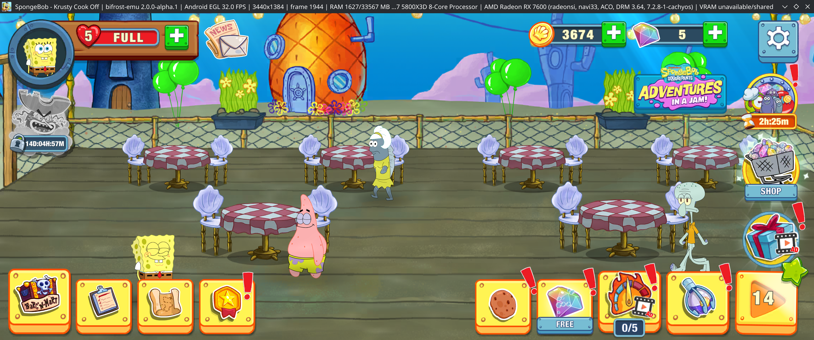
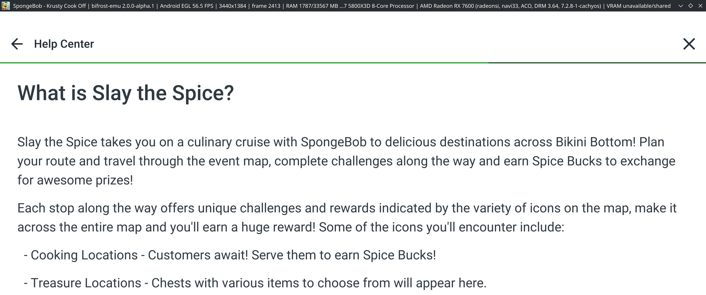

# SpongeBob - Krusty Cook-Off

Installed version: 5.12.0 (`com.tiltingpoint.spongebob`, pulled from the user's
phone). Runtime contracts and the bug history behind each checkpoint are in
[the Android runtime guide](../Android/ANDROID_RUNTIME.md).

As of 2026-10-14 the user plays cooking levels, completes them, opens Settings
and Help Center, and the main HUD stays after closing Settings. Play renders
at the host display's native density (2560x1384 or 3440x1384 px, 320 dpi on a
200%-scaled 3440x1440 monitor). The child-age path is required: the adult path
still stalls at 73% on Firebase/Google Play services.

## Screenshots (2026-10-14)

User-supplied captures from Bifrost 2.0.0-alpha.1 show the following scenes.
The titles report Android EGL at 3440x1384 and the Radeon RX 7600 renderer.
Their displayed 32.0–56.5 FPS values are momentary presentation statistics,
not a benchmark average or a claim of sustained frame pacing.

Cooking gameplay:

Level-14 pause menu:

Lobby and progression HUD:

Help Center article rendered inside the game:

These images document visible gameplay and UI states. They do not establish
working rewarded ads, purchases, Google Play-dependent features or complete
WebView input. Upcoming compatibility, performance, ads and usability targets
are in the [next-release roadmap](../roadmap.md#next-release-priorities).

## Fixed: character drawn incompletely after equipping (2026-10-12)

Equipping an outfit made SpongeBob lose his sponge body, base and nose on the
outfit screen, the main screen's avatar portrait and the level platforms.
Equipping runs Spine-Unity's `AtlasUtilities.GetRepackedSkin` (called from the
game's `AvatarCustomizer`), a CPU-side repack through `Texture2D.GetPixels`,
`SetPixels`/`Apply` and `PackTextures`; no GPU texture copy is involved. A
fallback profile diffed across one equip (`BIFROST_FALLBACK_PROFILE` with
`%p`, per process) listed the instructions the repack interpreted. Run against
QEMU, vector `FCVTL` (half to single, `0x0E217800`) returned garbage: only the
single-to-double form was implemented. Related half-precision and NaN defects
were fixed with it; see [the JIT guide](../JIT.md#half-precision-conversions-and-arm-nan-results-2026-10-12).
The user confirmed the character, portrait and lobby draw correctly afterwards.
Native-density rendering was ruled out first with `BIFROST_ANDROID_LOGICAL_PIXELS=1`.

## Fixed: IL2CPP heap corruption crash (2026-10-13)

A session left on the 73% loading screen exited with status 191 after 87 s.
Threads 94/306/308/311 faulted in `libil2cpp.so` (identified by matching the
logged instruction bytes; the emulated `/proc/self/maps` has no file names):
a NULL class at `+0x135`, a garbage array allocation, and a Boehm free-list
link containing the text `mscorlib`. Two threads had allocated the same
object. The cause was a replayed STLR store releasing the GC allocation lock
held by another thread; see [the JIT guide](../JIT.md#guest-memory-barriers).
The crash is rare in the game (a 240 s unattended run did not reproduce it);
the guest fixtures reproduce it in most runs.

## Open issues

### Kidoz ad stuck on its loading screen (2026-10-13)

The One Piece rewarded ad (Kidoz, MRAID/VAST player in a WebView, stacked
Activity) shows its "SpongeBob x One Piece" loading screen with an empty
progress bar and never reaches the ad itself. Observed by the user in two
sessions, before and after the max-bounds fix:

- The loading screen draws in the upper-left part of the 3440x1384 window
  rather than filling it. The player reports `screenWidth 1720,
  screenHeight 720` (the 3440x1440 monitor in dp at 2x).
- Right after the player's `getParams` call, a guest thread does
  `unmapped read at 0x0` (thread 157, then thread 155); the game keeps
  running but the ad stays on its loading screen.
- The main thread skips 120-190 frames every 2-3 seconds while the ad is
  up (`Choreographer: Skipped N frames`).
- Before the max-bounds fix it also logged "too large to fit into a
  software layer ... only 0 available"; that warning is gone and nothing
  visible changed.

Next steps: find the faulting PC and library for the null read, then compare
the WebView's layout size with the Activity window. Logs:
`android-state/com.tiltingpoint.spongebob/managed/sessions/0766a3a30f904fcaa889e32cefc16b94/`.

### No mail/news (2026-10-12, uninvestigated)

The phone shows mail in the news envelope; Bifrost shows none. Likely a
failed news fetch or service gap; no log evidence collected yet.
