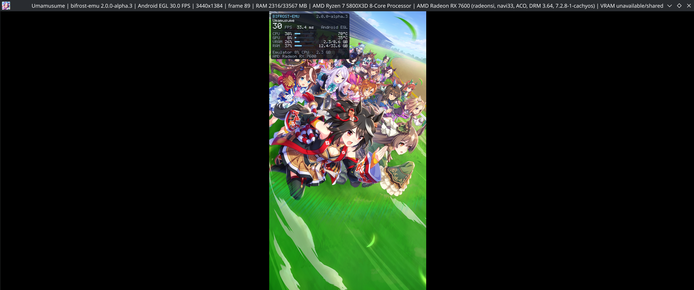
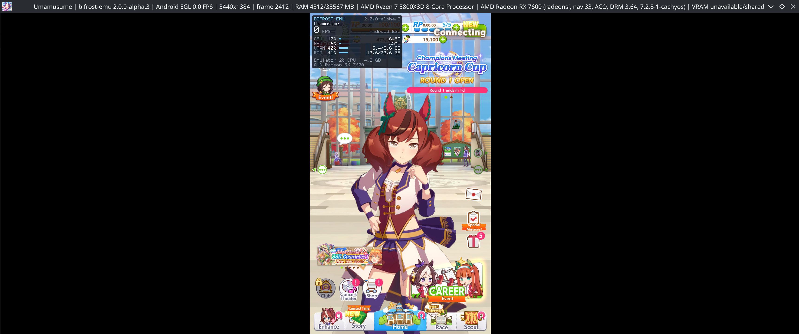
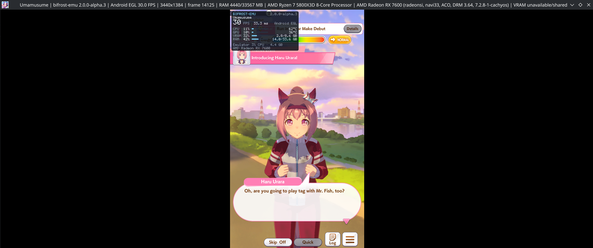
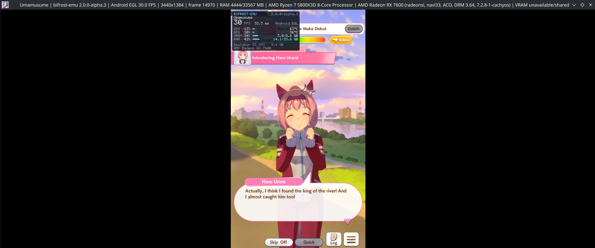
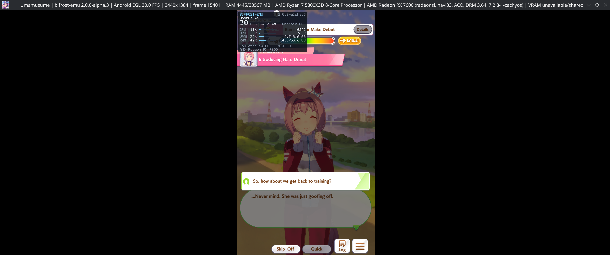
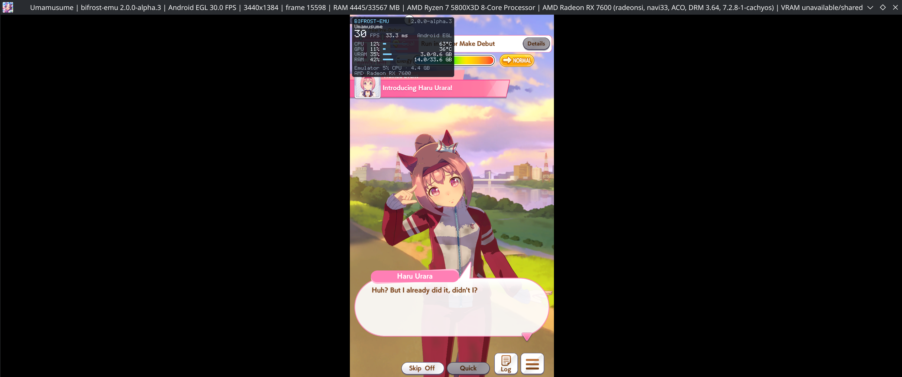

# Umamusume: Pretty Derby

Global package: `com.cygames.umamusume` (tested version 1.35.2).
Status: **playable**, from the user's reports on October 29 and November 1, 2026. The November 1 screenshots show the
title screen, the home screen and a Career story scene on Bifrost 2.0.0-alpha.3. The JP client
(`jp.co.cygames.umamusume`) is blocked by the game's device integrity check when it connects.

The Global client needs `ro.kernel.qemu` set to 0, or it exits about 6 seconds in:

```sh
python3 Scripts/Android/asgard.py config com.cygames.umamusume property.ro.kernel.qemu 0
```

## Measurements (2026-11-01, 2.0.0-alpha.3)

Read from the screenshots below, in one session with no other app running. These are single readings, not benchmarks.

| Time | Screen | FPS | Frame | RAM (title bar) | Machine CPU / GPU |
|---|---|---|---|---|---|
| 11:05:11 | Title | 30.0 | 89 | 2316 MB | 30% / 8% |
| 11:07:07 | Home, "Connecting" | 0.0 | 2412 | 4312 MB | 10% / 6% |
| 11:14:37 | Career story | 30.0 | 14125 | 4440 MB | 11% / 10% |
| 11:15:05 | Career story | 30.0 | 14970 | 4444 MB | 13% / 10% |
| 11:15:20 | Career story | 30.0 | 15401 | 4445 MB | 11% / 9% |
| 11:15:26 | Career story | 30.0 | 15598 | 4445 MB | 12% / 11% |

- **Frame rate:** the story scenes averaged about 30 FPS (1,473 frames in 49 seconds). With the machine this idle, 30 FPS
  looks like a cap rather than a limit of the emulator; where the cap comes from was not checked. The 0.0 FPS reading is
  one moment during "Connecting", so it does not show how long the pause lasted.
- **Memory:** the title bar counts the whole session by PSS ([window stats](../window-stats.md)). It reached about 4.3 GB
  by the home screen and then stayed near 4.4 GB, growing about 5 MB across the story readings.

## Screenshots (2026-11-01)

The window keeps the desktop's shape around the game's portrait area, so the black bars are outside the game. The stats
panel is a separate layer at the top-left of the game's area and covers part of its interface. It is drawn only because
statistics were turned on, and it does not take input.

Title screen:



Home screen, connecting:



Career story scene:









These still images do not measure frame pacing or long-session stability.

## Remaining work

- Capture a race, training and audio evidence; none of the screenshots shows them.
- Measure memory over a long session.
- Find where the 30 FPS cap comes from.
