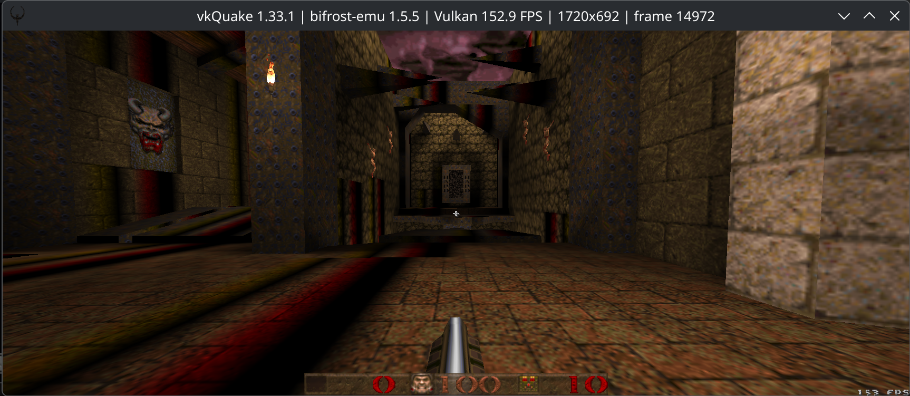
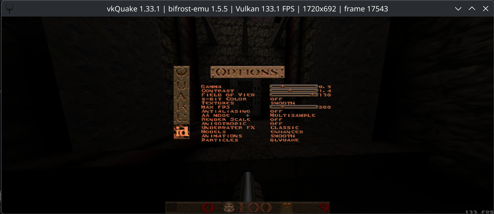

# vkQuake

On 2026-10-02 the user confirmed working gameplay with the repaired default
JIT build and supplied four screenshots showing the world, HUD, main menu,
help, and load menu. This is a Vulkan game bring-up milestone, with remaining
camera and rendering issues at that checkpoint; it is not a claim of
complete compatibility. The latest input report is recorded below.

The detailed investigation history (dated fixes, profiles, regressions) is in [the vkQuake history](../archive/apps/vkquake-history.md).

## Latest input follow-up (2026-10-04)

The user subsequently reported that the mouse issue was resolved. A connection
with the Doom 3 fixes is suspected by the user but has not been established.
Treat the excessive-sensitivity notes below as historical repro evidence;
repeatable axis/sensitivity/focus checks remain pending. Texture corruption
is still unresolved.

## Gameplay checkpoint (2026-10-04)

User-supplied gameplay shows the world, weapon and HUD at 1720×692. Remaining texture artifacts are visible; this does not establish complete rendering correctness. The FPS in the title is an instantaneous presentation sample, not a sustained benchmark.

