# Screenshots

User-supplied captures, not benchmarks, from October and November 2026. More are in the
[SpongeBob](Apps/spongebob.md#screenshots-2026-11-01), [Azur Lane](Apps/azur-lane.md#screenshots-2026-10-14) and
[Umamusume](Apps/umamusume.md#screenshots-2026-11-01) galleries. The project site shows the same pictures.

<table>
<tr>
<td>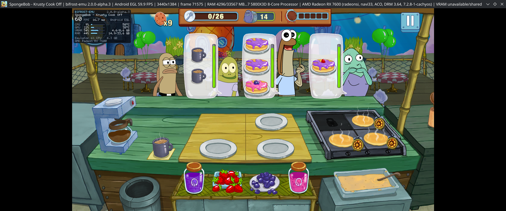 SpongeBob: Krusty Cook-Off (Android)</td>
<td>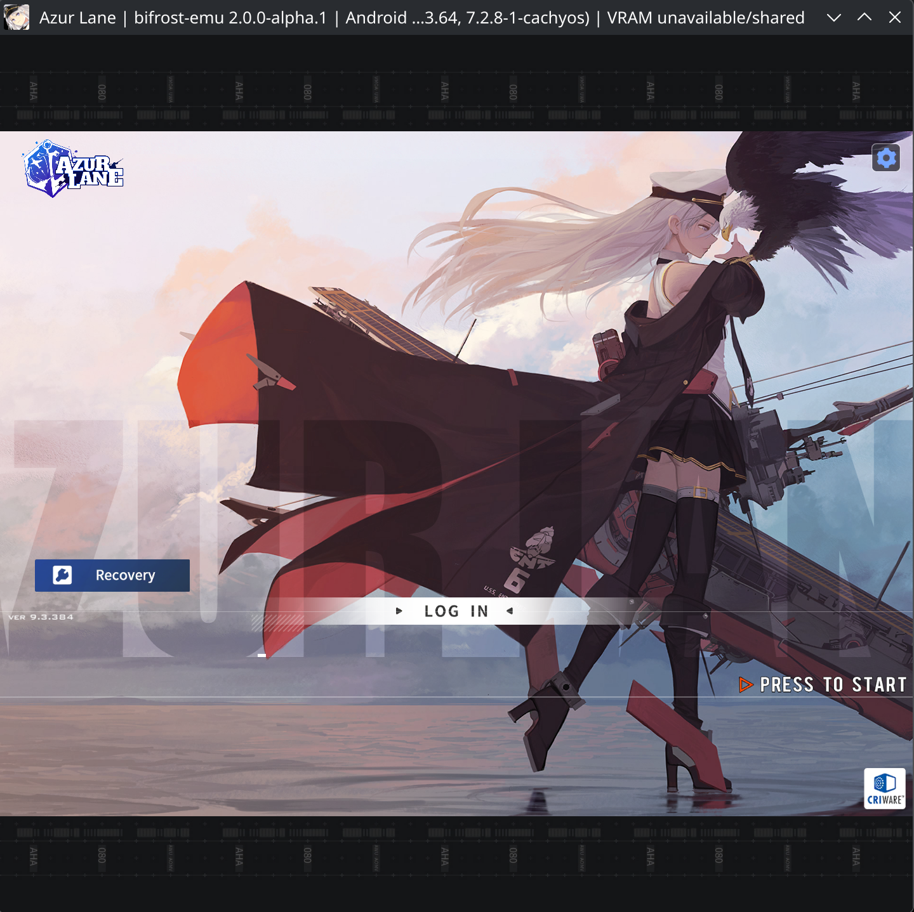 Azur Lane title/login (Android)</td>
<td>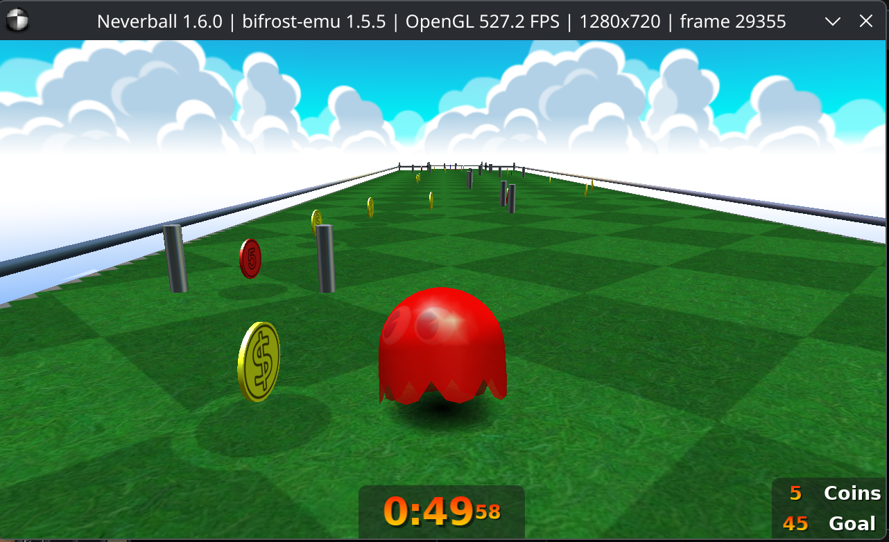 Neverball (Linux, SDL2/GL)</td>
</tr>
<tr>
<td>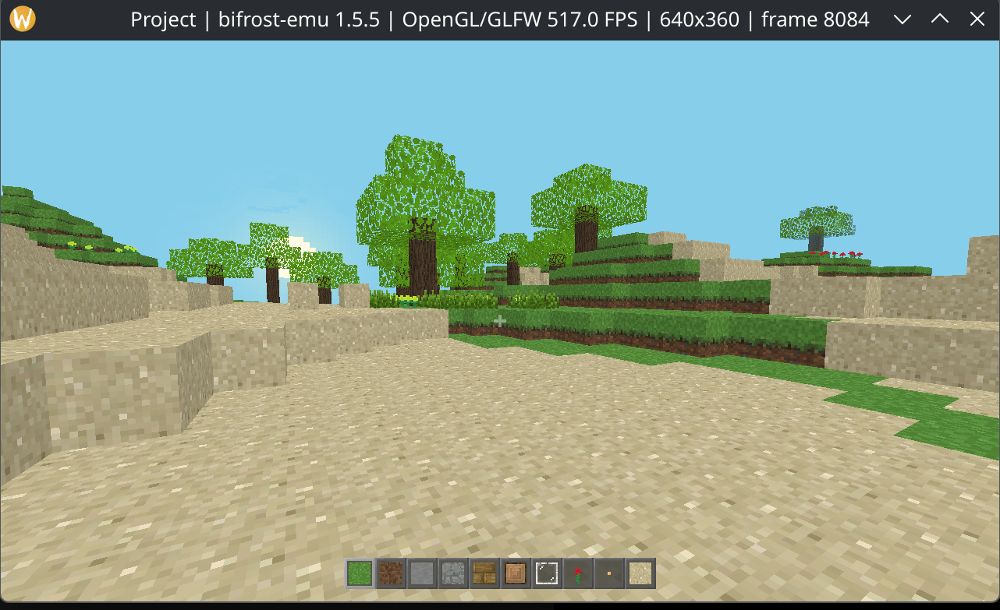 Minecraft Weekend (Linux)</td>
<td>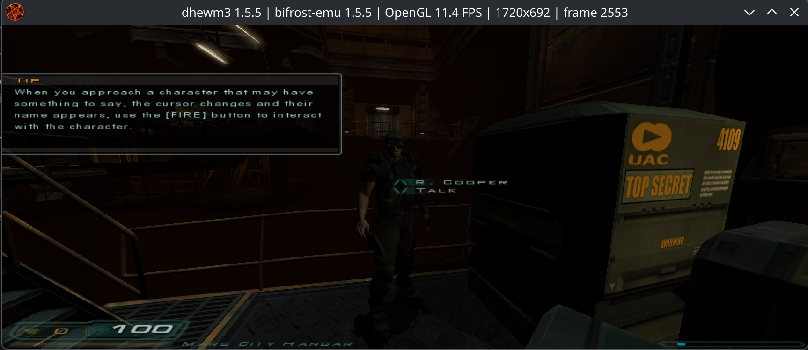 Doom 3 / dhewm3 (Linux)</td>
<td>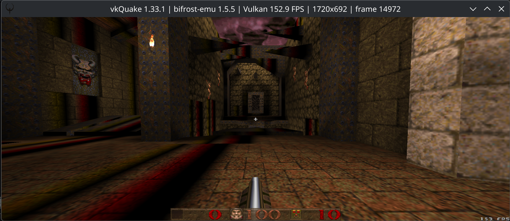 vkQuake (Linux, Vulkan)</td>
</tr>
</table>

<table>
<tr>
<td>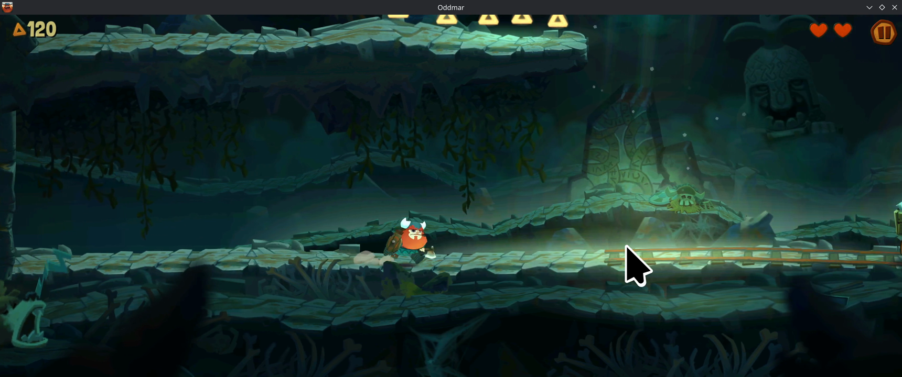 Oddmar, a cave level (Android)</td>
<td>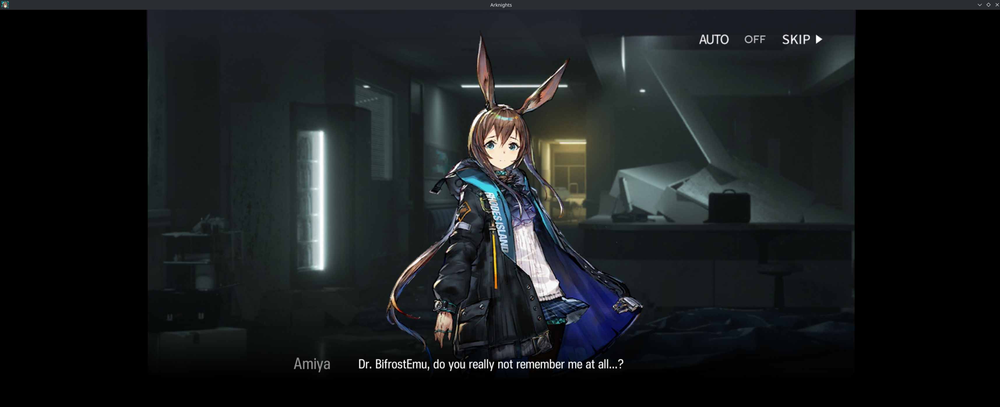 Arknights opening story (Android)</td>
<td>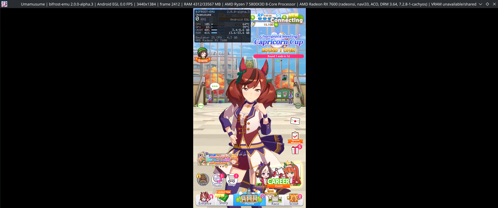 Umamusume: Pretty Derby home (Android)</td>
</tr>
<tr>
<td>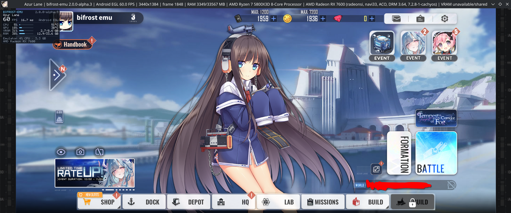 Azur Lane home screen (Android)</td>
<td>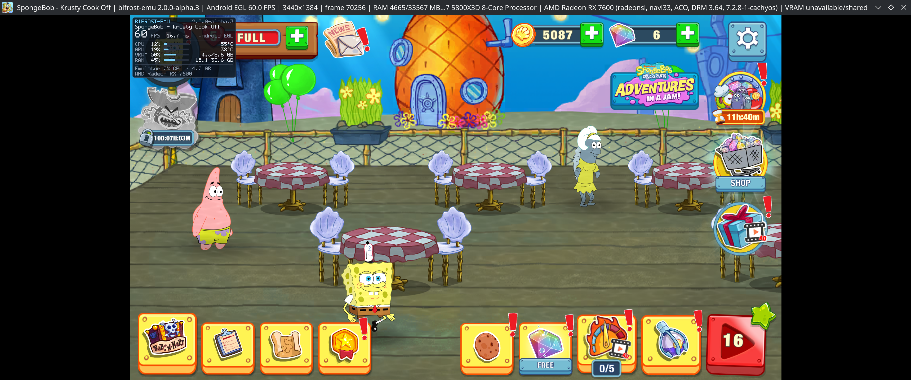 SpongeBob: Krusty Cook-Off lobby (Android)</td>
<td>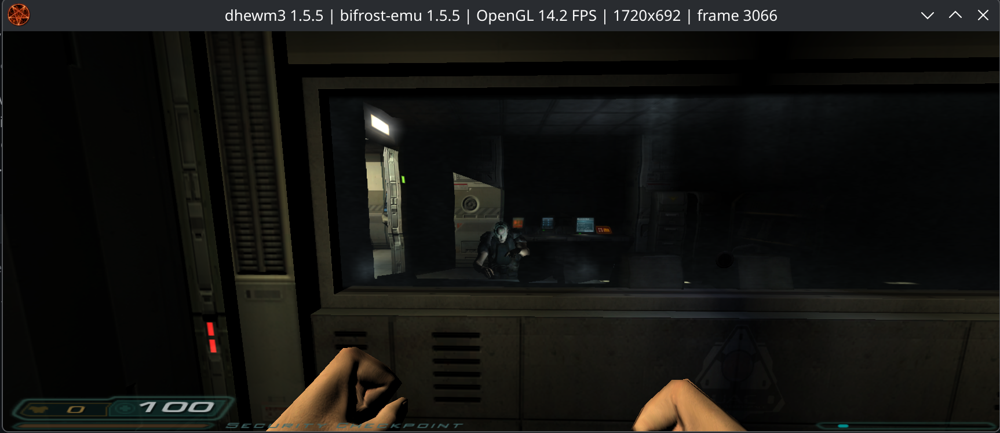 Doom 3 security checkpoint (Linux)</td>
</tr>
<tr>
<td>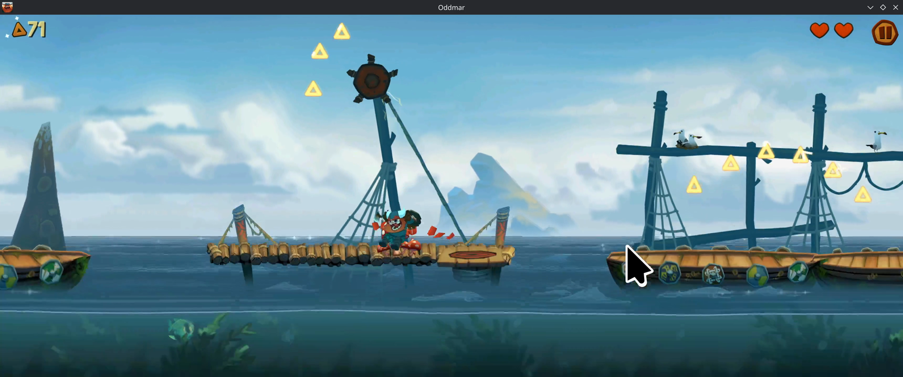 Oddmar, a harbour level (Android)</td>
<td>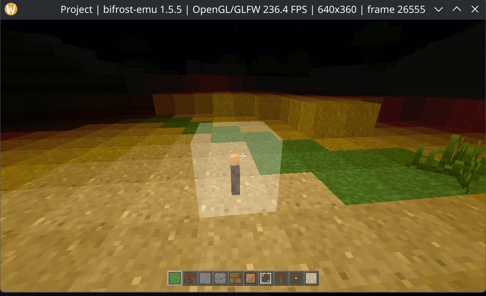 Minecraft Weekend at night (Linux)</td>
<td>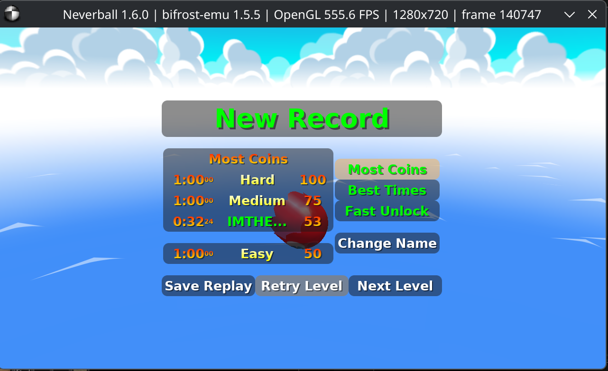 Neverball new record (Linux, SDL2/GL)</td>
</tr>
<tr>
<td>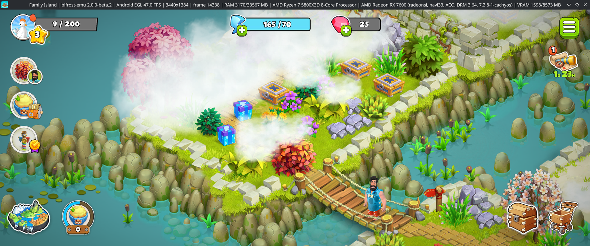 Family Island home island (Android)</td>
<td>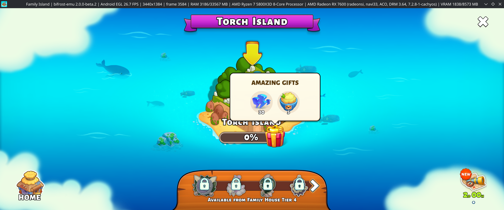 Family Island island map (Android)</td>
<td>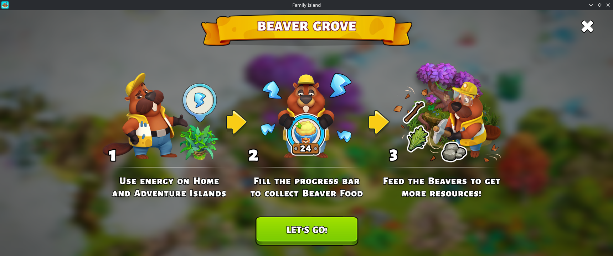 Family Island Beaver Grove (Android)</td>
</tr>
</table>
