# bifrost-emu

**Run ARM64 (AArch64) Linux programs, games and Android apps on an x86_64 Linux PC.** A JIT compiler translates them as they
run, so existing binaries need no cross-compiler and no QEMU.

**Website:** [sloppyman2567.github.io/bifrost-emu](https://sloppyman2567.github.io/bifrost-emu/): what runs, screenshots
and how to install.

[](https://github.com/sloppyman2567/bifrost-emu/actions/workflows/ci.yml)
[](http://unlicense.org/)
[](https://isocpp.org/)
[](Docs/SUPPORT.md)
[](Docs/CHANGELOG.md)
[](#what-runs)

---

## Highlights

- **FrostJIT** — ARM64 → typed IR → scalar SSA → x86_64, with block chaining, an indirect-branch cache and an optional Tier-2
  superblock compiler. A reference interpreter backs every instruction.
- **Checked against references** — instruction semantics (NaNs, rounding, signed zero, faults) are compared with QEMU and the Arm
  pseudocode, and `make verify` replays JIT blocks against the interpreter.
- **Android apps without a phone** — *Asgard* runs real Bionic, ART and the Android 15 framework. `bifrost-emu game.apk` installs
  and runs an app, and games built with Unity/IL2CPP, Cocos2d-x and Ren'Py run (see [What runs](#what-runs)).
- **Your real GPU, audio and input** — GL, EGL, GLES, Vulkan, SDL2/SDL3, ALSA and PulseAudio calls go to host libraries, and Android
  windows render at the monitor's native pixel density.
- **A Linux personality** — 200+ syscalls, threads, signals, futexes, userfaultfd, cooperative `ptrace`, and a virtual `/proc`,
  `/dev` and `/sys` (*Yggdrasil* VFS). Dynamic programs find an [installed rootfs](Docs/ROOTFS.md) without flags.
- **Embeddable** — a C API (`libbifrost`) and an Android native-bridge adapter; see [embedding](Docs/EMBEDDING.md).

## Quick start

You need an x86_64 Linux PC with SSE4.1 and FMA3, about 1.5 GB to download and about 1.1 GB of disk for the Android part.

```bash
git clone https://github.com/sloppyman2567/bifrost-emu && cd bifrost-emu
make bootstrap       # installs what it needs, builds, downloads the Android runtime; under ~/.local
```

Add `~/.local/bin` to your `PATH`. If a download stops, run the command again: it resumes. Then:

```bash
bifrost-emu game.apk              # installs and runs an Android app (.apk, .apkm, .apks, .xapk)
asgard launcher                   # a library of the apps you installed
bifrost-emu ./program-arm64       # runs an ARM64 Linux program
bifrost-emu --setup-rootfs        # once, if a Linux program needs shared libraries
```

| I want to | Go to |
|---|---|
| Install from Debian or Ubuntu packages, system-wide, or only the emulator | [Other ways to install](Docs/INSTALL.md#other-ways-to-install) |
| Use an immutable Fedora such as Bazzite | [Distrobox steps](Docs/INSTALL.md#an-immutable-fedora-such-as-bazzite) |
| Update or remove it | [Update and remove](Docs/INSTALL.md#update) |
| Know which distributions have been checked | [Support matrix](Docs/SUPPORT.md) |
| Run Linux programs that need libraries | [Rootfs guide](Docs/ROOTFS.md) |
| Install and manage Android apps | [APK guide](Docs/Android/ANDROID_APK.md) |

## What runs

**20 games recorded (2026-11-14): 17 playable** (13 Android, 4 Linux), **1 starts** without confirmed gameplay
(Teeworlds) and **2 are blocked** (Roblox, TrickCal). Umamusume counts as playable through its
Global client; its JP client is blocked. Apps such as YouTube and Firefox are not counted.

Statuses come from the linked pages and `Scripts/Android/compatibility.json`. "User-confirmed" and "user-reported" mean the
user played it on Bifrost, not that every feature has an automated test or a recorded capture. The full notes for every row (versions,
frame rates, known problems) are in [Docs/COMPATIBILITY.md](Docs/COMPATIBILITY.md).

| Program | Kind | Status |
|---|---|---|
| [SpongeBob – Krusty Cook-Off 5.12.0](Docs/Apps/spongebob.md) | Android, Unity/IL2CPP | User-confirmed cooking levels at about 60 FPS (2026-11-01). |
| [Azur Lane 9.3.7](Docs/Apps/azur-lane.md) | Android, Unity/IL2CPP | User-reported playable online through a finished battle (2026-11-01). |
| [Arknights 37.7.41](Docs/Apps/arknights.md) | Android, Unity/IL2CPP | User-reported playable: sign-in and a battle at about 60 FPS (2026-11-03). |
| The Battle Cats 15.6.1 | Android | User-reported playable (2026-10-29). |
| [Umamusume: Pretty Derby](Docs/Apps/umamusume.md) | Android, Unity | Global 1.35.2: user-reported playable (2026-11-01). JP 2.32.0: blocked by its integrity check. |
| Subway Surfers 3.70.3 | Android, Unity/IL2CPP | User-reported playable, ads work (2026-10-29). |
| Geometry Dash Lite 2.2.148 | Android, Cocos2d-x | User-reported playable (2026-10-29); ads only somewhat stable. |
| Zenless Zone Zero 3.3.0 | Android, Unity/IL2CPP, Vulkan | User-confirmed gameplay in the city and story scenes (2026-11-08); low-resolution textures and heavy lag. |
| Doki Doki Literature Club 1.3.11.1 | Android, Ren'Py (SDL2, GLES) | User-confirmed play into the story (2026-11-06). |
| Hungry Shark Evolution 14.5.0, Hungry Shark World 8.2.6 | Android | User-reported stable gameplay (2026-11-06); World's Play Games sign-in does not complete. |
| YouTube 21.42.247 | Android | Home screen, search and video playback seen (2026-10-28); not fully working. |
| [Oddmar](Docs/Apps/oddmar.md) | Android, Unity/IL2CPP | User-confirmed gameplay in the first level (2026-11-08); later levels not confirmed. |
| Family Island 2026370.1.94765 | Android, Defold | User-reported stable play (2026-11-14), about 27 to 47 FPS on the overlay. |
| Uptodown | Android | Draws its home list, then asks for all-files access, which Bifrost cannot grant. |
| Roblox, TrickCal | Android | Blocked: Roblox needs real Google attestation; TrickCal's anti-cheat ends it. |
| [Neverball 1.6.0](Docs/Apps/neverball.md) | Linux, SDL2/GL | User-confirmed stable gameplay, replays, menus and fonts. |
| [Minecraft Weekend](Docs/Apps/minecraft-weekend.md) | Linux, SDL2/GL voxel game | User-confirmed stable gameplay; chunk rendering can lag. |
| [vkQuake 1.33.1](Docs/Apps/vkquake.md) | Linux, Vulkan | User-confirmed gameplay and menus. |
| [Doom 3 (dhewm3)](Docs/Apps/doom3.md) | Linux, SDL2/GL | User-reported extended gameplay with audio, mostly 60 FPS (2026-11-01). |
| Teeworlds | Linux, SDL2/GL | Reaches its rendering menu with sound initialized. |
| BusyBox, ToyBox | Linux CLI | Covered by the regression suite. |
| CoreMark | Linux benchmark | CRC-validated runs through `Scripts/Bench/run_benchmarks.py`. |

## Screenshots

User-supplied captures, not benchmarks, from October and November 2026. More are in the
[SpongeBob](Docs/Apps/spongebob.md#screenshots-2026-11-01), [Azur Lane](Docs/Apps/azur-lane.md#screenshots-2026-10-14) and
[Umamusume](Docs/Apps/umamusume.md#screenshots-2026-11-01) galleries.

<table>
<tr>
<td><br><sub>SpongeBob: Krusty Cook-Off (Android)</sub></td>
<td>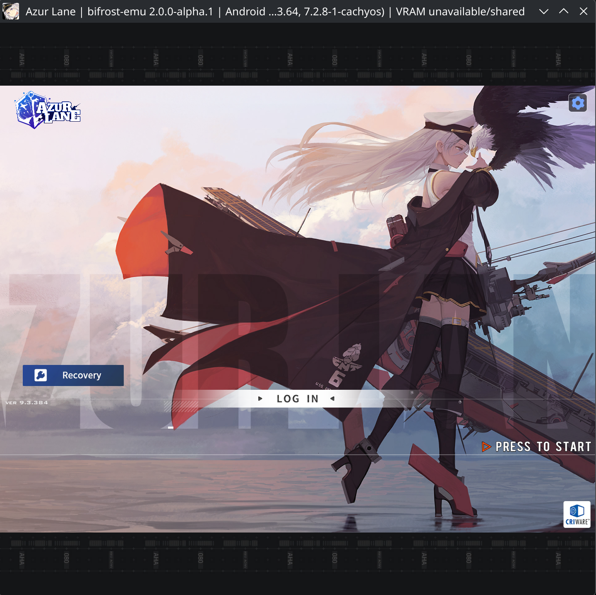<br><sub>Azur Lane title/login (Android)</sub></td>
<td><br><sub>Neverball (Linux, SDL2/GL)</sub></td>
</tr>
<tr>
<td>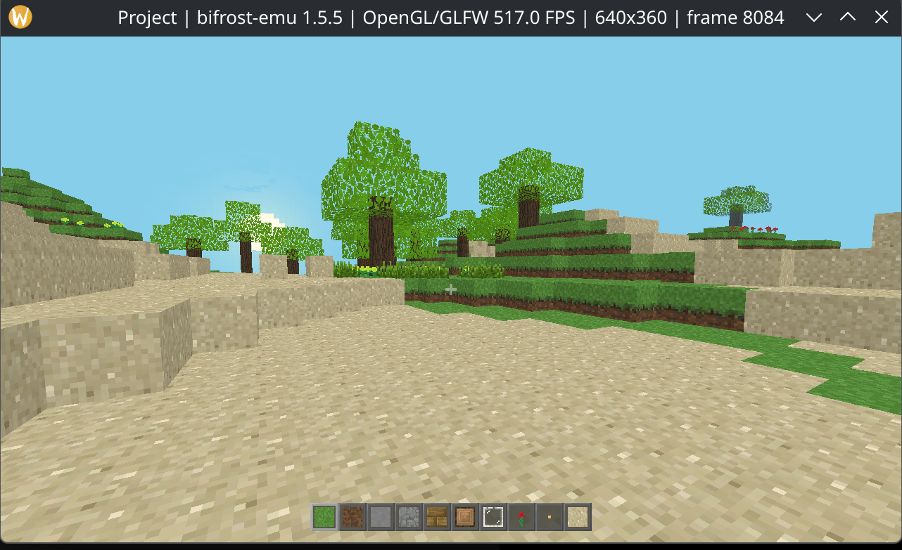<br><sub>Minecraft Weekend (Linux)</sub></td>
<td>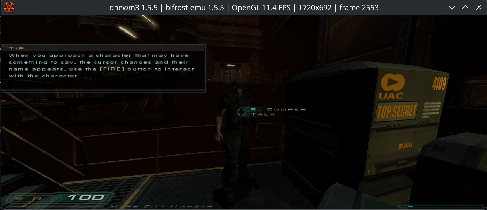<br><sub>Doom 3 / dhewm3 (Linux)</sub></td>
<td>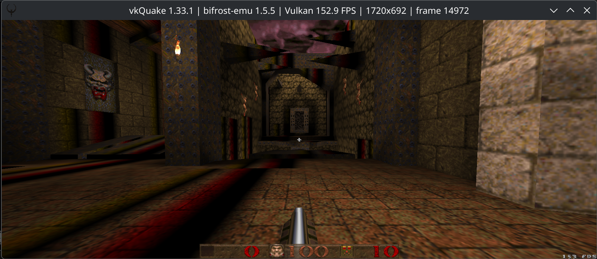<br><sub>vkQuake (Linux, Vulkan)</sub></td>
</tr>
</table>

<details>
<summary>More screenshots (12)</summary>

<table>
<tr>
<td>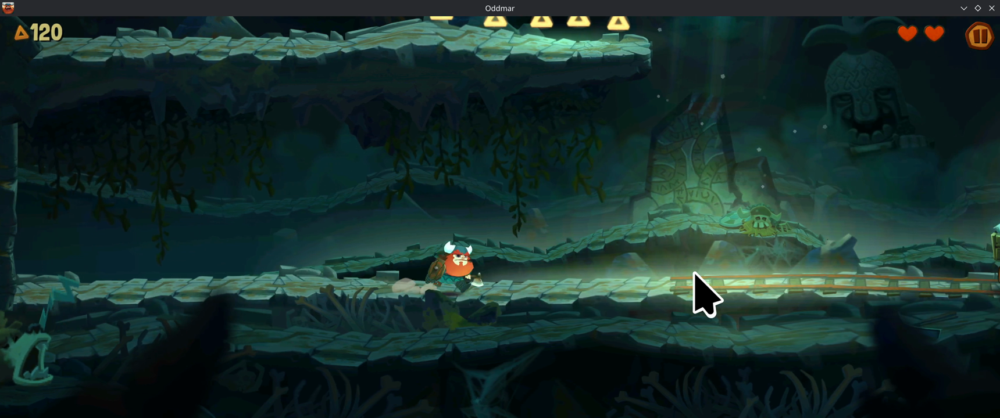<br><sub>Oddmar, a cave level (Android)</sub></td>
<td>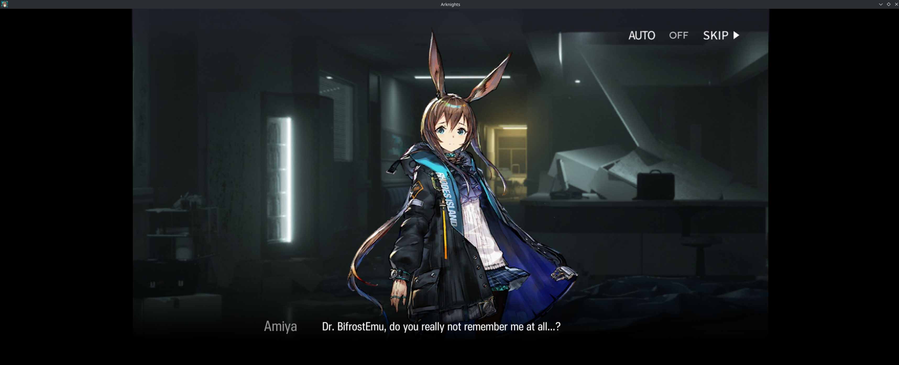<br><sub>Arknights opening story (Android)</sub></td>
<td>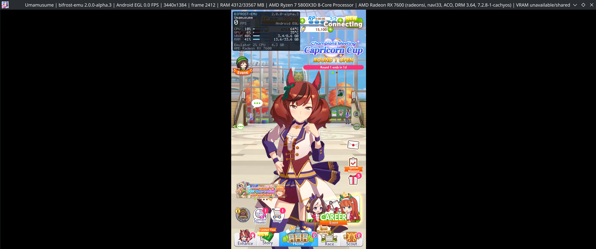<br><sub>Umamusume: Pretty Derby home (Android)</sub></td>
</tr>
<tr>
<td>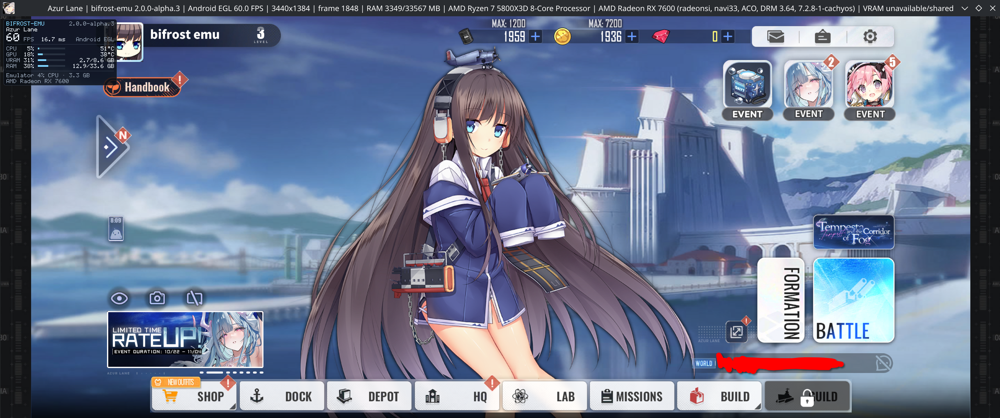<br><sub>Azur Lane home screen (Android)</sub></td>
<td>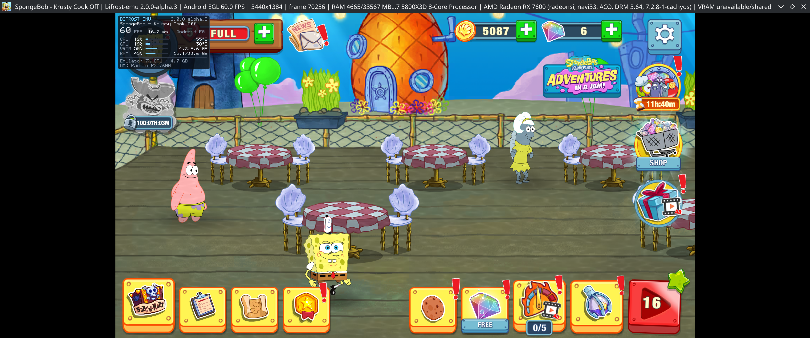<br><sub>SpongeBob: Krusty Cook-Off lobby (Android)</sub></td>
<td>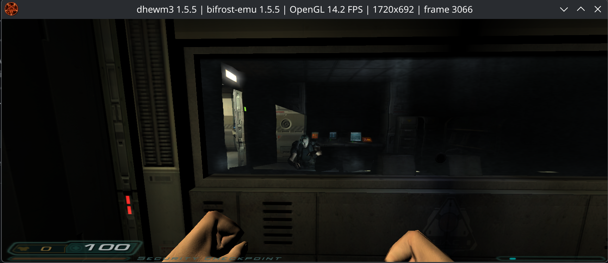<br><sub>Doom 3 security checkpoint (Linux)</sub></td>
</tr>
<tr>
<td>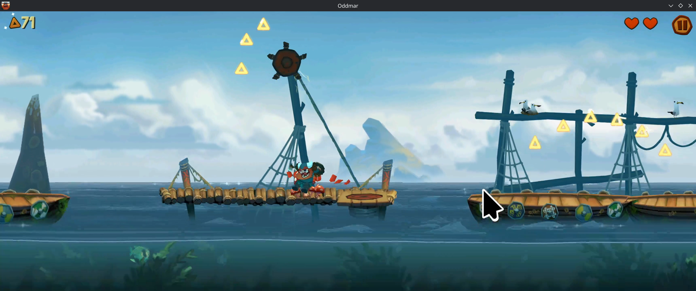<br><sub>Oddmar, a harbour level (Android)</sub></td>
<td>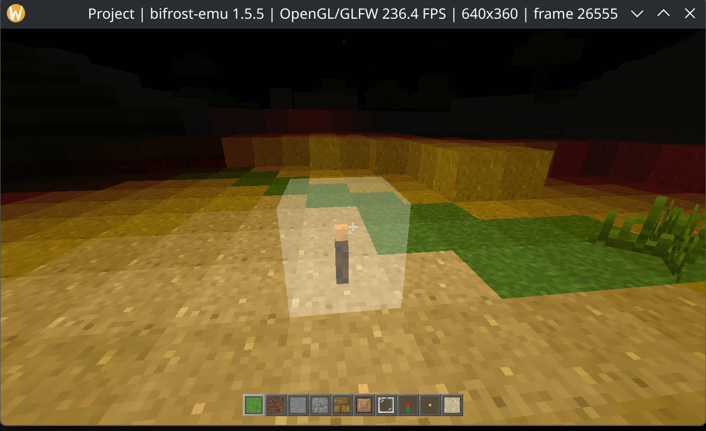<br><sub>Minecraft Weekend at night (Linux)</sub></td>
<td>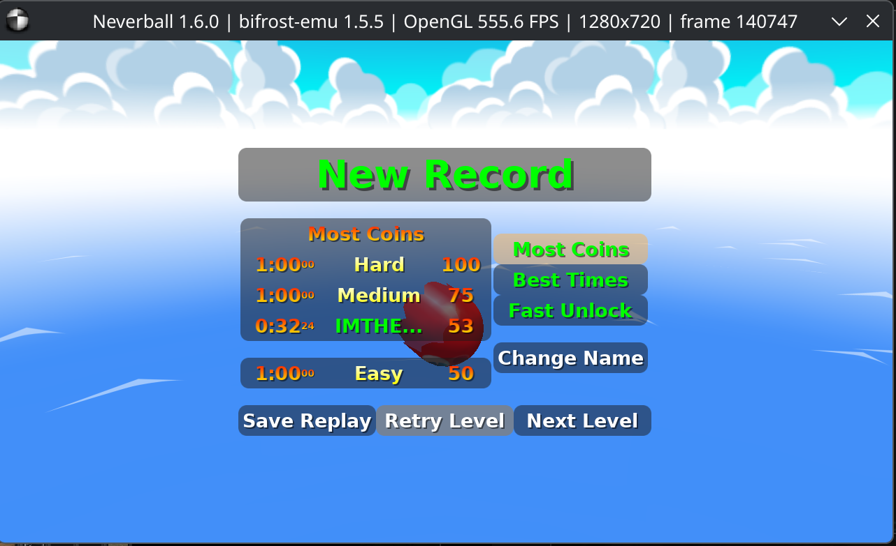<br><sub>Neverball new record (Linux, SDL2/GL)</sub></td>
</tr>
<tr>
<td>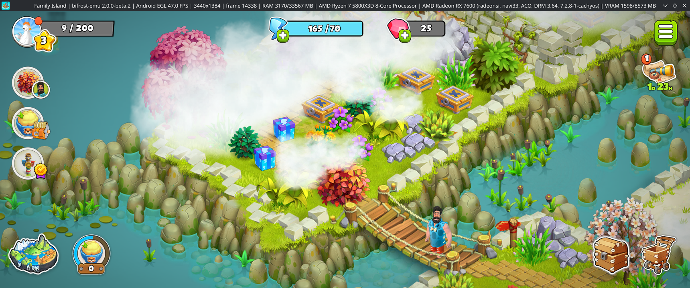<br><sub>Family Island home island (Android)</sub></td>
<td>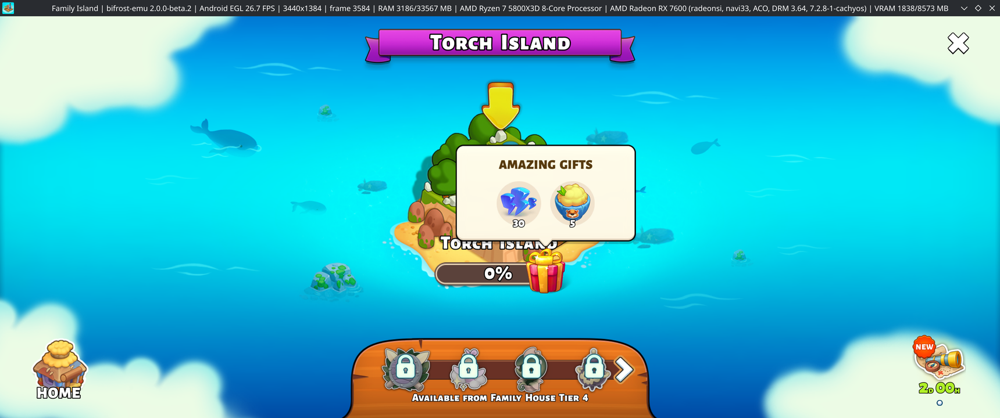<br><sub>Family Island island map (Android)</sub></td>
<td>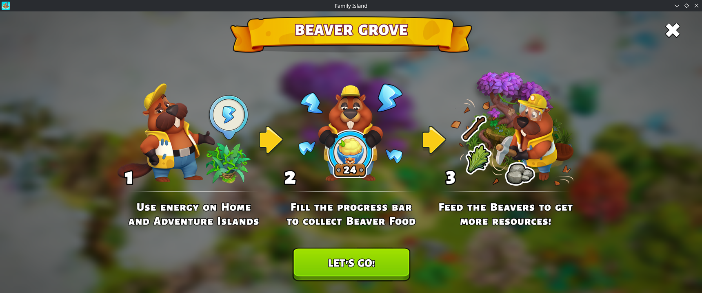<br><sub>Family Island Beaver Grove (Android)</sub></td>
</tr>
</table>

</details>

## Running programs

**Static ARM64 binaries** work out of the box: cross-compiled Go, Rust, C and C++ programs, static BusyBox and ToyBox, and game
engines that ship statically linked.

**Dynamically linked binaries** (glibc 2.36 through 2.40+, including DT_RELR, and musl) need a guest root filesystem for their
libraries; `bifrost-emu --setup-rootfs` installs one ([details](Docs/ROOTFS.md)). Shared libraries, GOT/PLT relocation, TLS, ifuncs,
versioned symbols and constructors work, and glibc's threads, mutexes, condition variables and `__thread` TLS work end to end.

**Android apps** run through *Asgard*, Bifrost's Android layer. It boots a real guest `linker64`, Bionic and ART and supplies Android 15
framework services (Activities, windows and dialogs, input, audio, display, package queries, JobScheduler and more) from a managed
launcher, with a shared Binder broker connecting an app's processes (game, WebView, services).

```bash
bifrost-emu game.apk                                # installs if needed, then runs it
asgard launcher                                     # the desktop library: install, play, settings, last session (a gamepad works too)
asgard config org.example.package network offline   # a per-app setting, applied at every start
asgard clear-data org.example.package               # reset saves; `asgard uninstall` removes the app
```

In a checkout that is not installed, use `python3 Scripts/Android/asgard.py` for `asgard`. In a game window **F11** toggles fullscreen
and the size is remembered per app. `./bifrost-emu --android libgame.so` runs a native `NativeActivity` library directly.

Android support is experimental: Google Play services come from microG (sign-in works up to Google's own page), and media decoding
and many system services are partial or missing. The [APK guide](Docs/Android/ANDROID_APK.md) lists every command and setting; see also
the [runtime guide](Docs/Android/ANDROID_RUNTIME.md), [Binder](Docs/Android/ANDROID_BINDER.md) and
[window plugins](Docs/Android/ANDROID_WINDOW_PLUGINS.md).

## Progress

**2.0.0-beta.2** (2026-11-14) is the current pre-release. The goals for it and what follows are in the [roadmap](Docs/roadmap.md);
everything that changed is in the [changelog](Docs/CHANGELOG.md). Since 2.0.0-alpha.2:

- **Install and run:** `bifrost-emu app.apk` installs and runs an Android package, `make bootstrap` and the Debian packages install
  Bifrost and Asgard, and an installable rootfs lets dynamic programs run without flags.
- **Faster JIT:** fewer generated bytes and fewer host instructions per guest instruction (CoreMark 11.9% fewer), native NEON forms
  for pixel, media and vector code, and opt-in Tier-2 regions that follow calls and returns.
- **Android launches:** a session Zygote (WebView ready in about 0.8 s instead of 3.4 s on one game), one shared read-only copy of
  Android for every game, and faster launch preparation.
- **Android and graphics:** a Vulkan device through a guest HAL, an app Keystore, real GPU fences for WebView, more service
  contracts, and ASTC textures presented to Vulkan apps on GPUs without ASTC (converted to BC7 on the CPU).
- **Game windows and library:** fullscreen with F11, a remembered window size, pause while hidden, and **Set up…** in the library.
- **Linux personality:** guest `ptrace` and pseudo terminals, `/proc/<pid>/status`, and fork/exec fixes.
- **Open:** measured frame times, zero-copy frames, WebView interaction, behaviour on real compositors, and sustained play. Most of
  the above is checked with fixtures and on one machine, not on every game or desktop, and a passing build or a launch is not
  gameplay. The changelog has the caveats for each item.

## Architecture

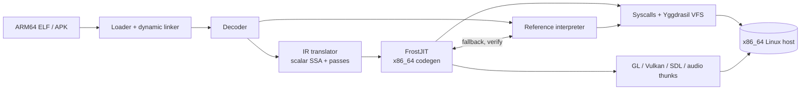

| Component | Location | Role |
|---|---|---|
| ELF loader | `Source/System/Loader/ElfLoader.cpp` | Static and PIE binaries, RELA relocations |
| Dynamic linker | `Source/System/Loader/DynamicLinker/` | DT_NEEDED, GOT/PLT, TLS, ifuncs, versioned symbols |
| Decoder | `Source/Interpreter/Decoder/` | Shared AArch64 decoder for both engines |
| IR translator | `Source/FrostJIT/IR/` | Typed IR, scalar SSA, optimization and validation |
| FrostJIT | `Source/FrostJIT/` | x86_64 code generation, register allocation, dispatch, Tier-2 |
| Interpreter | `Source/Interpreter/` | Reference semantics and JIT fallback |
| Syscalls | `Source/System/Syscalls/` | 200+ Linux AArch64 syscalls by family |
| Yggdrasil VFS | `Source/System/VFS/` | Virtual `/proc`, `/dev`, `/sys`, framebuffer, audio, input |
| Threads/signals | `Source/System/Core/` | `clone`, futexes, signal delivery, shared JIT |
| Thunks | `Source/System/Graphics/`, `Source/System/Audio/` | Host GL/EGL/Vulkan/SDL/audio forwarding |
| Asgard | `Source/System/Android/`, `Guest/Android/` | Binder, surfaces, loopers, managed framework services |

The [source layout](Docs/ARCHITECTURE.md) and [JIT guide](Docs/JIT.md) go
deeper. Host forwarding and input are described in
[host integration](Docs/HOST_INTEGRATION.md).

## Building

| Requirement | Needed for |
|---|---|
| g++ 9+ (C++17), make, Linux x86_64 | Everything (required) |
| x86-64 CPU with SSE4.1 and FMA3 | The JIT (`--no-jit` runs on any x86-64 CPU, much more slowly) |
| SDL2 development headers (`./Tools/Fetch/fetch-sdl2-headers.sh`) | Framebuffer, guest SDL2 and GL thunks |
| SDL3 ≥ 3.2 headers and runtime | Android host windows |
| FFmpeg libavcodec/libavutil/libswscale development files | Android host media decoding (`USE_MEDIA=1`, default) |
| AArch64 cross toolchain (`./Tools/Fetch/fetch-musl-toolchain.sh`) | Building guest test programs |

`make deps` installs all of these except the cross toolchain, using apt, dnf, zypper or pacman
([what has been checked](Docs/SUPPORT.md)).

| Command | Builds |
|---|---|
| `make bootstrap` | Host packages, the emulator and Asgard, installed under `~/.local` or `PREFIX` |
| `make` | Default; auto-detects SDL2 and enables host GL/EGL thunking |
| `make USE_SDL2=1 USE_SDL3=1 USE_THUNK_GL=1` | Android SDL3 windows plus guest SDL2/GL thunks |
| `make USE_SDL2=0 USE_SDL3=0` | Headless build |
| `make USE_MEDIA=0` | No host media decoders; Codec2 advertises no host codecs |
| `make debug` | Sanitizer build at `build/debug/bifrost-emu-dbg` |
| `make lib` | `libbifrost.a` for [embedding](Docs/EMBEDDING.md) |

Each configuration gets its own `build/release-sdl*-gl*` directory; the default
release binary is also copied to `./bifrost-emu`. `make clean` removes them all.
Guest test programs build with `make setup-tests`, or one at a time with
`make cross SRC=Tests/Apps/my_test.c OUT=Tests/Apps/my_test.elf`.

## Testing

```bash
make check            # standard suite (benchmarks included)
make check-quick      # without benchmarks
make check-nojit      # quick suite under the interpreter
make verify           # replay JIT blocks against the interpreter
make ci               # local correctness gate (generated files, APIs, both engines)
./Scripts/Testing/run_tests.sh --strict --filter "sig|brk|pipe"   # by name
```

Missing fixtures fail strict mode, and environment skips (exit 77) stay visible. Results, history and fixture licensing are in the
[test guide](Docs/TESTS.md) and the [third-party notes](Docs/THIRD_PARTY.md).

## Configuration

Settings come from a TOML file, environment variables and flags:

```bash
./bifrost-emu --config bifrost.toml my_app.elf   # use a config file
./bifrost-emu --print-config                     # show effective settings

BIFROST_ROOT=/path/to/rootfs    # guest root filesystem
BIFROST_TIER2=1                 # experimental Tier-2 region compilation
BIFROST_JIT_VERIFY=1            # JIT vs interpreter divergence check
BIFROST_SYSCALL_TRACE=1         # trace syscalls
BIFROST_DYNLINK_TRACE=1         # trace the dynamic linker
BIFROST_THUNK_TRACE=1           # trace host GL/audio/display calls
```

Useful switches: `-d` traces every instruction, `--no-jit` forces the interpreter, `--window-stats` shows FPS and load statistics
(see [window stats](Docs/window-stats.md)), and the experimental `--jit-disk-cache` keeps translations in `~/.cache/bifrost/jit` so
later launches start faster ([JIT guide](Docs/JIT.md#persistent-translation-cache)). [`bifrost.toml.sample`](bifrost.toml.sample)
lists every option, and `Source/System/Core/DebugFlags.hpp` lists the diagnostic switches.

## Performance

CoreMark (November 8, 2026), measured on a Ryzen 7 5800X3D with the CPU governor on `performance` (boost on): 160,000 iterations,
one warmup and three interleaved measured runs per binary, every CRC validated. The method and its limits are in
[the JIT history](Docs/archive/JIT-history.md#coremark-re-measurement-2026-11-08).

| Build | Median iterations/s |
|---|---|
| bifrost-emu 2.0.0-beta.1 tree (JIT, shipped SDL/GL build) | 14,874 |
| same code, headless build | 14,753 |
| bifrost-emu 2.0.0-alpha.2 (JIT, headless build) | 12,711 |
| QEMU 11.1.1 user mode (TCG) | 7,992 |

On this integer and control-flow benchmark the shipped build is about 86% faster than QEMU, and the headless build of the same code
is about 16% faster than the alpha.2 release built the same way. Neither predicts game FPS. The runs spread 1% to 2.5%, so
differences of a few percent are noise: compare numbers within one table, not across dates.

The `bench_*` programs (same host, median of three runs, each program's own timer except `bench_mips`, which is process wall time;
JIT compilation is included, so the millisecond-scale times are coarse):

| Benchmark | Interpreter | JIT | Speedup |
|---|---|---|---|
| fib(35) | 7.35 s | 0.076 s | ~97x |
| memcpy 256 MiB | 171 MiB/s | ~9,390 MiB/s | ~55x |
| qsort 100K ints | 4.51 s | 0.076 s | ~59x |
| matrix 256×256 | 11.9 MFLOPS | ~1,129 MFLOPS | ~95x |
| bench_mips (800M instructions) | ~51 MIPS | ~4,515 MIPS | ~89x |

Repeatable runs with checksums and host metadata: `Scripts/Bench/run_benchmarks.py`. The JIT uses AVX-512, AVX2, SSE4.2,
AES-NI/PCLMULQDQ/SHA-NI, BMI1/BMI2 and FMA3 where the host has them, with fallbacks. Game profiling notes live on each app page, for
example [Doom 3](Docs/Apps/doom3.md).

## Embedding

```c
#include "Bifrost.h"

bifrost_emu_t* emu = bifrost_create();
bifrost_load_elf(emu, "hello.elf", argc, argv);
int exit_code = bifrost_run(emu);   // JIT on by default
bifrost_destroy(emu);
```

The C API also offers register and memory access, stepping with breakpoints,
guest function calls, symbol lookup, syscall hooks and guest `dlopen`. The
[embedding guide](Docs/EMBEDDING.md) covers it and the Android native-bridge
adapter.

## Limitations

- **User mode only** — no kernel or full-system emulation (use QEMU system mode).
- **AArch64 guests only** — no 32-bit ARM, so an Android APK that ships only `armeabi-v7a` or `x86` libraries cannot start.
- **x86_64 Linux hosts only** — other distributions are expected to work, but only Ubuntu 24.04 is CI-built; see the
  [support matrix](Docs/SUPPORT.md).
- **Android is experimental** — Google Play services and a complete system_server are absent, full in-game video and rewarded-ad
  playback are unverified, and window behaviour has been checked with fakes, not on every compositor.
- **Untrusted binaries** — read the [security model](Docs/SECURITY.md) first.

## Documentation

The current version is **2.0.0-beta.2**, the second beta pre-release toward the [v2.0 roadmap](Docs/roadmap.md); its goals are not
complete yet.

| Topic | Document |
|---|---|
| What runs | [Full notes](Docs/COMPATIBILITY.md); [SpongeBob](Docs/Apps/spongebob.md), [Azur Lane](Docs/Apps/azur-lane.md), [Arknights](Docs/Apps/arknights.md), [Oddmar](Docs/Apps/oddmar.md), [Umamusume](Docs/Apps/umamusume.md), [Neverball](Docs/Apps/neverball.md), [Minecraft Weekend](Docs/Apps/minecraft-weekend.md), [vkQuake](Docs/Apps/vkquake.md), [Doom 3](Docs/Apps/doom3.md), [zstd](Docs/Apps/zstd.md) |
| JIT internals | [JIT guide](Docs/JIT.md) |
| Source layout | [Architecture](Docs/ARCHITECTURE.md) |
| Android | [Runtime](Docs/Android/ANDROID_RUNTIME.md), [runtime reference](Docs/Android/ANDROID_RUNTIME_REFERENCE.md), [APKs](Docs/Android/ANDROID_APK.md), [Binder](Docs/Android/ANDROID_BINDER.md), [window plugins](Docs/Android/ANDROID_WINDOW_PLUGINS.md) |
| Host graphics, audio and input | [Host integration](Docs/HOST_INTEGRATION.md), [window stats](Docs/window-stats.md) |
| Embedding | [C API and native bridge](Docs/EMBEDDING.md) |
| Support and security | [Support matrix](Docs/SUPPORT.md), [security model](Docs/SECURITY.md) |
| Tests and history | [Test guide](Docs/TESTS.md), [changelog](Docs/CHANGELOG.md) (releases before 2.0.0-alpha.3 are in `Docs/archive/`), and the dated [test](Docs/archive/TESTS-history.md), [JIT](Docs/archive/JIT-history.md) and [runtime](Docs/archive/ANDROID_RUNTIME-history.md) history, [third-party notes](Docs/THIRD_PARTY.md); per-app investigation logs are in `Docs/archive/apps/` |
| Licensing | [License scope and texts](LICENSES/README.md) |
| Configuration | [`bifrost.toml.sample`](bifrost.toml.sample) |

## License

Bifrost's original code, original Asgard integration and original regression
tests use the [Unlicense](LICENSE). Reused AOSP material keeps its upstream
license; [LICENSES/](LICENSES/README.md) includes Apache 2.0 and Android source
attribution alongside the project license. Third-party fixtures, vendored
dependencies and game assets keep their own terms. See
[third-party and test distribution notes](Docs/THIRD_PARTY.md).

## Contributing

1. Fork the repository and follow the existing code style.
2. Build guest fixtures with `make setup-tests`, then run the relevant JIT and
   interpreter checks (`make check-all` for provisioned coverage).
3. For JIT changes, read the [JIT guide](Docs/JIT.md) and run `make verify`;
   report existing verifier failures separately from new ones.
4. Preserve upstream notices for reused code and include validation evidence
   with your pull request. Original contributions, including tests, use the
   Unlicense; reused code retains its upstream license and attribution.

Bug reports help most with the AArch64 binary (or a minimal reproducer), the
exact command line, and the tail of `./bifrost-emu -v -d ... 2>&1`.
