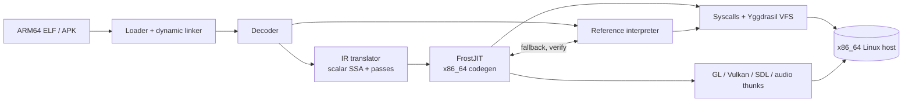

# bifrost-emu

```
  ____ _____ ______ _____   ____   _____ _______
 |  _ \_   _|  ____|  __ \ / __ \ / ____|__   __|
 | |_) || | | |__  | |__) | |  | | (___    | |
 |  _ < | | |  __| |  _  /| |  | |\___ \   | |
 | |_) || |_| |    | | \ \| |__| |____) |  | |
 |____/_____|_|    |_|  \_\\____/|_____/   |_|

  bifrost-emu  v2.0.0-alpha.1
  x86_64 ◄─────────────────► ARM64
```

**A bridge between worlds.** Run ARM64 (AArch64) Linux programs, games and
Android apps on an x86_64 Linux PC, translated on the fly by a JIT compiler.
Existing binaries need no cross-compiler and no QEMU.

[](https://github.com/sloppyman2567/bifrost-emu/actions/workflows/ci.yml)
[](http://unlicense.org/)
[](https://isocpp.org/)
[](Docs/SUPPORT.md)
[](Docs/CHANGELOG.md)

---

## Highlights

- **FrostJIT** — ARM64 → typed IR → scalar SSA → x86_64, with block chaining,
  an indirect-branch cache and an optional Tier-2 superblock compiler.
  A switch-based reference interpreter backs every instruction.
- **Checked against references** — instruction semantics (NaNs, rounding,
  signed zero, Q=0 lanes, faults) are compared with QEMU and the Arm pseudocode;
  `make verify` replays JIT blocks against the interpreter.
- **Android apps without a phone** — *Asgard* runs real Bionic, ART and the
  Android 15 framework with a shared Binder broker, installs signed APK sets
  and plays a Unity/IL2CPP game.
- **Your real GPU, audio and input** — GL, EGL, GLES, Vulkan, SDL2/SDL3, ALSA
  and PulseAudio calls are forwarded to host libraries; Android windows render
  at the monitor's native pixel density.
- **A Linux personality** — 200+ syscalls, threads, signals, futexes,
  userfaultfd, and a virtual `/proc`, `/dev` and `/sys` (*Yggdrasil* VFS).
- **Embeddable** — a C API (`libbifrost`) and an Android native-bridge
  adapter; see [embedding](Docs/EMBEDDING.md).

## What runs

Statuses come from the linked pages; "user-confirmed" means the user played it
on Bifrost, not that every feature has an automated test.

| Program | Kind | Status |
|---|---|---|
| [SpongeBob – Krusty Cook-Off 5.12.0](Docs/Apps/spongebob.md) | Android, Unity/IL2CPP | User-confirmed cooking levels, outfits and menus at native resolution. Child-age path; the adult path waits on Google Play services. |
| [Neverball 1.6.0](Docs/Apps/neverball.md) | Linux, SDL2/GL | User-confirmed stable gameplay, replays, menus and fonts. |
| [Minecraft Weekend](Docs/Apps/minecraft-weekend.md) | Linux, SDL2/GL voxel game | User-confirmed stable gameplay; chunk rendering can lag. |
| [vkQuake 1.33.1](Docs/Apps/vkquake.md) | Linux, Vulkan | User-confirmed gameplay and menus; texture corruption remains. |
| [Doom 3 (dhewm3)](Docs/Apps/doom3.md) | Linux, SDL2/GL | User-reported extended gameplay with audio and animation; demanding scenes are slow. |
| Teeworlds | Linux, SDL2/GL | Reaches its rendering menu with sound initialized. |
| BusyBox, ToyBox | Linux CLI | Covered by the regression suite. |
| CoreMark | Linux benchmark | CRC-validated runs through `Scripts/Bench/run_benchmarks.py`. |

## Quick start

```bash
make                                   # build (SDL2/GL thunks auto-detected)
./bifrost-emu hello.elf                # run a static ARM64 binary
./bifrost-emu -v Tests/Apps/fib.elf    # print execution stats on exit
./bifrost-emu Tests/Apps/toybox seq 1 10   # arguments pass through
```

Dynamically linked programs need a guest root filesystem:

```bash
./Scripts/Setup/setup-rootfs-all.sh    # glibc + musl toolchains and libraries (~250 MB)
./bifrost-emu --rootfs $PWD/rootfs my_dynamic_app.elf   # or export BIFROST_ROOT
```

Android apps install from a signed APK, APKM or APKS bundle:

```bash
python3 Scripts/Android/android_package.py install /path/to/game.apkm
python3 Scripts/Android/android_package.py run org.example.game
```

Useful switches: `-d` traces every instruction, `--no-jit` forces the
interpreter, `--no-window-stats` removes the FPS title, and `BIFROST_TIER2=1`
enables experimental Tier-2 region compilation.

## Running programs

### Static binaries

Static AArch64 ELF binaries work out of the box. This covers most
cross-compiled Go, Rust, C and C++ programs, static BusyBox and ToyBox, and
game engines that ship statically linked.

### Dynamically linked binaries

Both **glibc** (2.36 through 2.40+, including DT_RELR) and **musl** guests are
supported, with shared libraries, GOT/PLT relocation, TLS, ifuncs, versioned
symbols and constructors. glibc's NPTL threads, mutexes, condition variables
and `__thread` TLS work end to end across multiple thread waves. The rootfs
setup can also be done step by step:

```bash
./Tools/Fetch/fetch-glibc-toolchain.sh     # glibc toolchain (130 MB)
./Tools/Fetch/fetch-musl-toolchain.sh      # musl toolchain (104 MB)
./Scripts/Setup/setup-rootfs.sh            # rootfs with glibc + musl libraries
./Scripts/Setup/fetch-realworld-libs.sh    # libselinux, libpcre2, libssl, ...
./Scripts/Setup/fetch-curl-deps.sh         # curl's 24 dependency libraries
```

The rootfs provides both dynamic loaders and libcs, `/etc` basics, timezone
data, and Android-style `/system`, `/data` and `/sdcard` scaffolding.

### Android apps (Asgard)

**Asgard** is Bifrost's Android compatibility layer. It boots a real guest
`linker64`, Bionic and ART, and supplies Android 15 framework services from a
managed launcher: Activities, windows and dialogs, input, audio, display,
package queries, JobScheduler and more. An app supervisor and shared Binder
broker connect an app's processes (game, WebView, services).

```bash
python3 Tools/Android/fetch-android-runtime.py         # one-time runtime setup
python3 Tools/Android/fetch-aapt2.py
python3 Tools/Android/fetch-android-package-tools.py
make android-runtime-adapters android-managed-launcher
python3 Scripts/Android/android_package.py install /path/to/package.apkm
python3 Scripts/Android/android_package.py run org.example.package
python3 Scripts/Android/asgard.py realm status        # inspect the shared realm
```

Native `NativeActivity` libraries can also run directly with
`./bifrost-emu --android libgame.so`. Android support is experimental: Google
Play services, media decoding and many system services are not provided. See
the [Android runtime guide](Docs/Android/ANDROID_RUNTIME.md),
[APK tooling](Docs/Android/ANDROID_APK.md),
[Binder](Docs/Android/ANDROID_BINDER.md) and
[window plugins](Docs/Android/ANDROID_WINDOW_PLUGINS.md).

## Architecture



| Component | Location | Role |
|---|---|---|
| ELF loader | `Source/System/Loader/ElfLoader.cpp` | Static and PIE binaries, RELA relocations |
| Dynamic linker | `Source/System/Loader/DynamicLinker/` | DT_NEEDED, GOT/PLT, TLS, ifuncs, versioned symbols |
| Decoder | `Source/Interpreter/Decoder/` | Shared AArch64 decoder for both engines |
| IR translator | `Source/FrostJIT/IR/` | Typed IR, scalar SSA, optimization and validation |
| FrostJIT | `Source/FrostJIT/` | x86_64 code generation, register allocation, dispatch, Tier-2 |
| Interpreter | `Source/Interpreter/` | Reference semantics and JIT fallback |
| Syscalls | `Source/System/Syscalls/` | 200+ Linux AArch64 syscalls by family |
| Yggdrasil VFS | `Source/System/VFS/` | Virtual `/proc`, `/dev`, `/sys`, framebuffer, audio, input |
| Threads/signals | `Source/System/Core/` | `clone`, futexes, signal delivery, shared JIT |
| Thunks | `Source/System/Graphics/`, `Source/System/Audio/` | Host GL/EGL/Vulkan/SDL/audio forwarding |
| Asgard | `Source/System/Android/`, `Guest/Android/` | Binder, surfaces, loopers, managed framework services |

The [source layout](Docs/ARCHITECTURE.md) and [JIT guide](Docs/JIT.md) go
deeper. Host forwarding and input are described in
[host integration](Docs/HOST_INTEGRATION.md).

## Building

| Requirement | Needed for |
|---|---|
| g++ 9+ (C++17), make, Linux x86_64 | Everything (required) |
| SDL2 development headers (`./Tools/Fetch/fetch-sdl2-headers.sh`) | Framebuffer, guest SDL2 and GL thunks |
| SDL3 ≥ 3.2 headers and runtime | Android host windows |
| AArch64 cross toolchain (`./Tools/Fetch/fetch-musl-toolchain.sh`) | Building guest test programs |

| Command | Builds |
|---|---|
| `make` | Default; auto-detects SDL2 and enables host GL/EGL thunking |
| `make USE_SDL2=1 USE_SDL3=1 USE_THUNK_GL=1` | Android SDL3 windows plus guest SDL2/GL thunks |
| `make USE_SDL2=0 USE_SDL3=0` | Headless build |
| `make debug` | Sanitizer build at `build/debug/bifrost-emu-dbg` |
| `make lib` | `libbifrost.a` for [embedding](Docs/EMBEDDING.md) |

Each configuration gets its own `build/release-sdl*-gl*` directory; the default
release binary is also copied to `./bifrost-emu`. `make clean` removes them all.
Guest test programs build with `make setup-tests`, or one at a time with
`make cross SRC=Tests/Apps/my_test.c OUT=Tests/Apps/my_test.elf`.

## Testing

```bash
make check            # standard suite (benchmarks included)
make check-quick      # without benchmarks
make check-nojit      # quick suite under the interpreter
make verify           # replay JIT blocks against the interpreter
make ci               # local correctness gate (generated files, APIs, both engines)
./Scripts/Testing/run_tests.sh --strict --filter "sig|brk|pipe"   # by name
```

On 2026-10-12, with every fixture provisioned, the strict suite passed
**315/315** under the JIT and **306/306** under the interpreter (nine JIT-only
tests skipped), and `make verify` passed 77 differential fixtures plus six
threaded oracle runs. Missing fixtures fail strict mode; environment skips
(exit 77) stay visible. Details, history and fixture licensing are in
[test evidence](Docs/TESTS.md) and [third-party notes](Docs/THIRD_PARTY.md).

## Configuration

Settings come from a TOML file, environment variables and flags:

```bash
./bifrost-emu --config bifrost.toml my_app.elf   # use a config file
./bifrost-emu --print-config                     # show effective settings

BIFROST_ROOT=/path/to/rootfs    # guest root filesystem
BIFROST_TIER2=1                 # experimental Tier-2 region compilation
BIFROST_JIT_VERIFY=1            # JIT vs interpreter divergence check
BIFROST_SYSCALL_TRACE=1         # trace syscalls
BIFROST_DYNLINK_TRACE=1         # trace the dynamic linker
BIFROST_THUNK_TRACE=1           # trace host GL/audio/display calls
```

[`bifrost.toml.sample`](bifrost.toml.sample) lists every option;
`Source/System/Core/DebugFlags.hpp` lists the diagnostic switches.

## Performance

CoreMark, 110,000 iterations, three runs each, CRCs validated, on a Ryzen 7
5800X3D (2026-10-12):

| Emulator | Median iterations/s |
|---|---|
| bifrost-emu 2.0.0-alpha.1 (JIT, Tier-1) | 8,565 |
| QEMU 11.1.1 user mode (TCG) | 7,910 |

That is about 8% faster on this integer/control-flow benchmark; it does not
predict game FPS. Earlier development measurements from the `bench_*` programs
(Ryzen 7 5800X3D, GCC -O3, not rerun for this update):

| Benchmark | Interpreter | JIT | Speedup |
|---|---|---|---|
| fib(35) | 6.4 s | 0.20 s | ~32x |
| memcpy 256 MiB | 238 MiB/s | ~2,990 MiB/s | ~13x |
| qsort 100K ints | 4.0 s | 0.27 s | ~15x |
| matrix 256×256 | 15.2 MFLOPS | ~641 MFLOPS | ~42x |
| bench_mips (800M instructions) | ~56 MIPS | ~4,400 MIPS | ~78x |

Repeatable runs with checksums and host metadata: `Scripts/Bench/run_benchmarks.py`.
The JIT uses AVX-512, AVX2, SSE4.2, AES-NI/PCLMULQDQ/SHA-NI, BMI1/BMI2 and
FMA3 where the host has them, with fallbacks. Game profiling notes live
on each app page, for example [Doom 3](Docs/Apps/doom3.md).

## Embedding

```c
#include "Bifrost.h"

bifrost_emu_t* emu = bifrost_create();
bifrost_load_elf(emu, "hello.elf", argc, argv);
int exit_code = bifrost_run(emu);   // JIT on by default
bifrost_destroy(emu);
```

The C API also offers register and memory access, stepping with breakpoints,
guest function calls, symbol lookup, syscall hooks and guest `dlopen`. The
[embedding guide](Docs/EMBEDDING.md) covers it and the Android native-bridge
adapter.

## Limitations

- **User mode only** — no kernel or full-system emulation (use QEMU system mode).
- **AArch64 guests only** — no 32-bit ARM.
- **x86_64 Linux hosts only** — other distributions are expected to work but
  only Ubuntu 24.04 is CI-built; see the [support matrix](Docs/SUPPORT.md).
- **Android is experimental** — no Google Play services, media decoding or
  complete system_server.
- **Untrusted binaries** — read the [security model](Docs/SECURITY.md) first.

## Documentation

The current version is **2.0.0-alpha.1**, the first pre-release toward the
[v2.0 roadmap](Docs/roadmap.md); its goals are not complete yet.

| Topic | Document |
|---|---|
| App status | [SpongeBob](Docs/Apps/spongebob.md), [Neverball](Docs/Apps/neverball.md), [Minecraft Weekend](Docs/Apps/minecraft-weekend.md), [vkQuake](Docs/Apps/vkquake.md), [Doom 3](Docs/Apps/doom3.md), [zstd](Docs/Apps/zstd.md) |
| JIT internals | [JIT guide](Docs/JIT.md) |
| Source layout | [Architecture](Docs/ARCHITECTURE.md) |
| Android | [Runtime](Docs/Android/ANDROID_RUNTIME.md), [APKs](Docs/Android/ANDROID_APK.md), [Binder](Docs/Android/ANDROID_BINDER.md), [window plugins](Docs/Android/ANDROID_WINDOW_PLUGINS.md) |
| Host graphics, audio and input | [Host integration](Docs/HOST_INTEGRATION.md), [window stats](Docs/window-stats.md) |
| Embedding | [C API and native bridge](Docs/EMBEDDING.md) |
| Support and security | [Support matrix](Docs/SUPPORT.md), [security model](Docs/SECURITY.md) |
| Tests and history | [Test evidence](Docs/TESTS.md), [changelog](Docs/CHANGELOG.md), [third-party notes](Docs/THIRD_PARTY.md) |
| Configuration | [`bifrost.toml.sample`](bifrost.toml.sample) |

## License

Bifrost's original code and original regression tests use the
[Unlicense](LICENSE). Third-party fixtures, vendored dependencies and game
assets keep their own terms; the root license does not relicense them. See
[third-party and test distribution notes](Docs/THIRD_PARTY.md).

## Contributing

1. Fork the repository and follow the existing code style.
2. Build guest fixtures with `make setup-tests`, then run the relevant JIT and
   interpreter checks (`make check-all` for provisioned coverage).
3. For JIT changes, read the [JIT guide](Docs/JIT.md) and run `make verify`;
   report existing verifier failures separately from new ones.
4. Preserve upstream notices for reused code and include validation evidence
   with your pull request. Original contributions, including tests, use the
   Unlicense.

Bug reports help most with the AArch64 binary (or a minimal reproducer), the
exact command line, and the tail of `./bifrost-emu -v -d ... 2>&1`.
