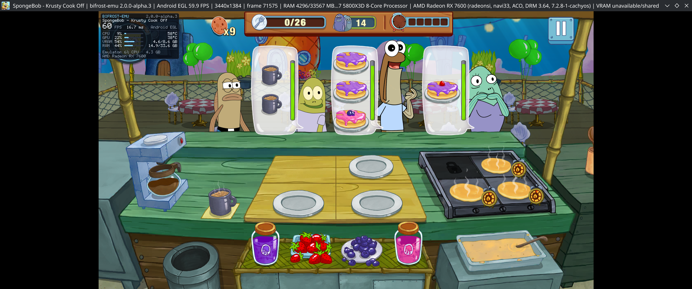
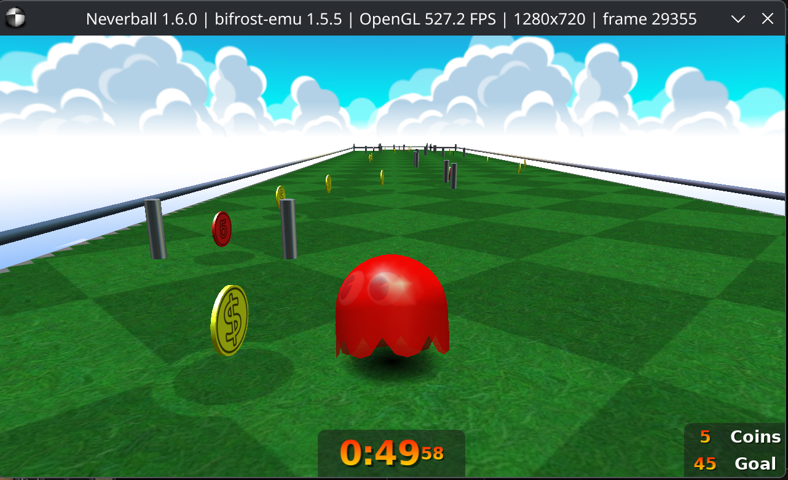

<div align="center">


# bifrost-emu

Play Android games and run ARM64 Linux programs on an ordinary x86_64 Linux PC.

[Website](https://sloppyman2567.github.io/bifrost-emu/) · [Install](Docs/INSTALL.md) · [What has been run](Docs/COMPATIBILITY.md) · [Screenshots](Docs/SCREENSHOTS.md) · [Changelog](Docs/CHANGELOG.md)

[](https://github.com/sloppyman2567/bifrost-emu/actions/workflows/ci.yml)
[](Docs/CHANGELOG.md)
[](Docs/COMPATIBILITY.md)
[](http://unlicense.org/)





</div>

## What it is

Give bifrost-emu an `.apk` or an ARM64 program and it runs it on your PC, using your own graphics card, sound and controller.
There is no phone, no emulated device and no virtual machine to set up. It translates the program while it runs.

| | |
|---|---|
| Bifrost | Runs ARM64 Linux programs: command-line tools, SDL and OpenGL games, Vulkan games. |
| Asgard | Its Android layer. `bifrost-emu game.apk` installs a game and starts it, and `asgard launcher` opens a library of what you installed. |

It is a beta. Some games play well, others only start, and a few are blocked.

## Quick start

You need an x86_64 Linux PC with SSE4.1 and FMA3, about 1.5 GB to download and about 1.1 GB of disk for the Android part.

```bash
git clone https://github.com/sloppyman2567/bifrost-emu && cd bifrost-emu
make bootstrap       # installs what it needs, builds, downloads the Android runtime; under ~/.local
```

Add `~/.local/bin` to your `PATH`. If a download stops, run the command again: it resumes. Then:

```bash
bifrost-emu game.apk              # installs and runs an Android app (.apk, .apkm, .apks, .xapk)
asgard launcher                   # a library of the apps you installed
bifrost-emu ./program-arm64       # runs an ARM64 Linux program
bifrost-emu --setup-rootfs        # once, if a Linux program needs shared libraries
```

Updating, removing, Debian packages and immutable systems such as Bazzite are in [Install and update](Docs/INSTALL.md).

## Does my game run?

17 of the 20 games tried so far are playable, according to the people who played them: SpongeBob Krusty Cook-Off, Azur Lane,
Arknights, Umamusume (Global), Subway Surfers, Neverball, Doom 3 and more. Roblox and TrickCal are blocked. The full list, with
versions, frame rates and known problems, is [What has been run](Docs/COMPATIBILITY.md).

## Good to know

| | |
|---|---|
| Android is experimental | Google Play services come from microG, so Google sign-in works only up to Google's own page. Media decoding and many system services are partial or missing. |
| ARM64 only | An app that ships only 32-bit ARM or x86 code cannot start. |
| x86_64 Linux only | Other distributions should work, but only Ubuntu 24.04 is tested in CI; see the [support matrix](Docs/SUPPORT.md). |
| Untrusted programs | Read the [security model](Docs/SECURITY.md) before running anything you do not trust. |

## Learn more

| I want to | Read |
|---|---|
| Install, update or remove | [Install and update](Docs/INSTALL.md) |
| Manage Android apps, settings and saves | [APK guide](Docs/Android/ANDROID_APK.md) |
| Run Linux programs that need libraries | [Rootfs guide](Docs/ROOTFS.md) |
| See what is planned | [Roadmap](Docs/roadmap.md) and [changelog](Docs/CHANGELOG.md) |
| Build it, change settings, report a bug or contribute | [Build, configure and contribute](Docs/BUILDING.md) |
| Understand how it works | [Source layout](Docs/ARCHITECTURE.md), [JIT guide](Docs/JIT.md), [speed](Docs/PERFORMANCE.md) |
| Use it from my own program | [Embedding](Docs/EMBEDDING.md) |
| Run the tests | [Test guide](Docs/TESTS.md) |

## License

The original code is under the [Unlicense](LICENSE). Reused Android material keeps its own licence, and so do third-party
fixtures and game assets: see [LICENSES/](LICENSES/README.md) and the [third-party notes](Docs/THIRD_PARTY.md).
