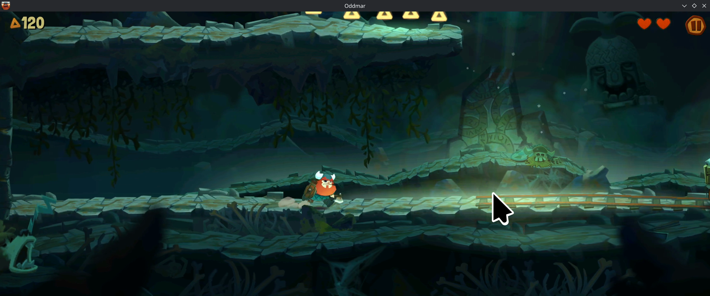
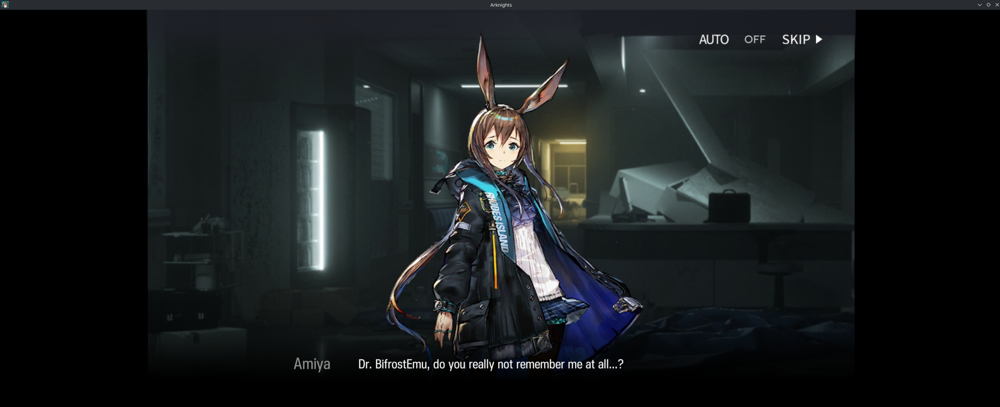
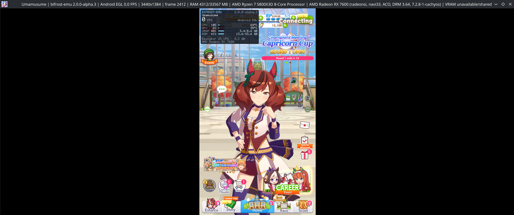
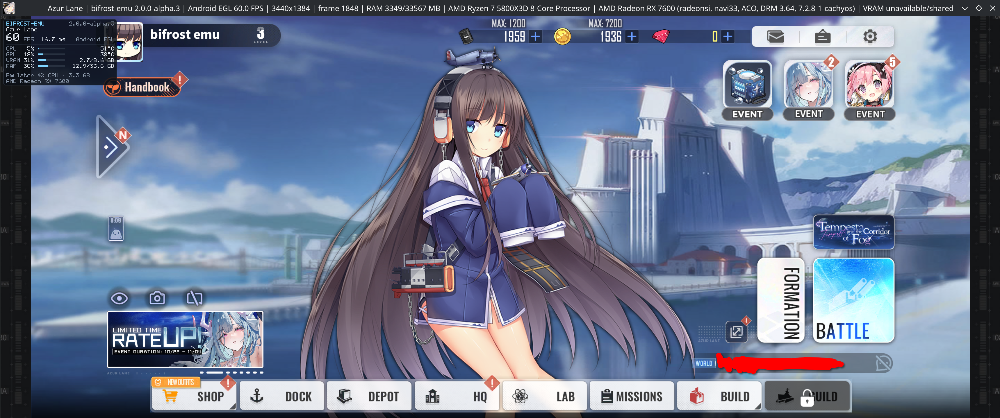
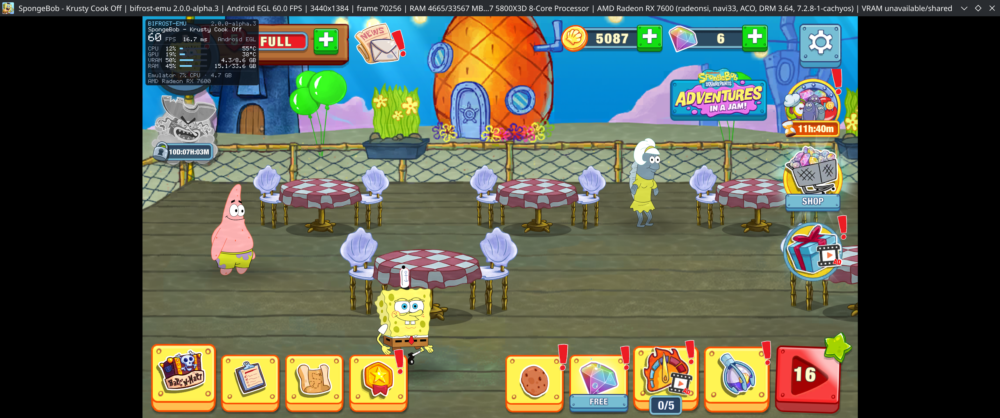
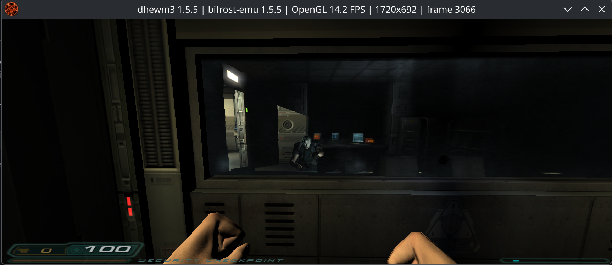
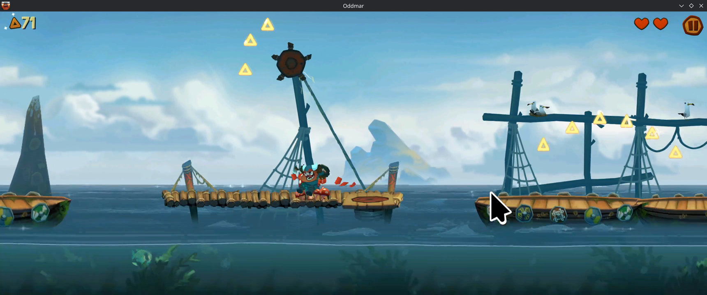
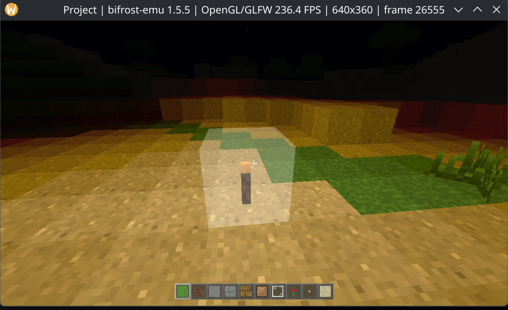
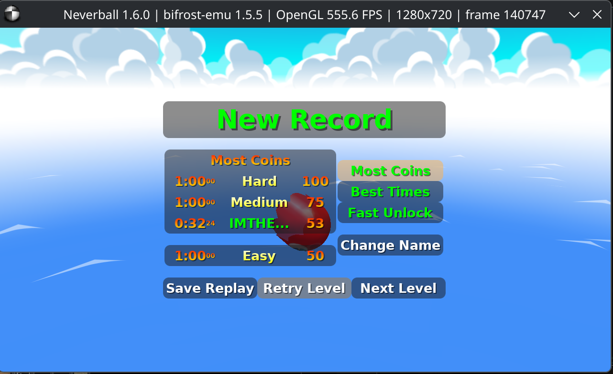
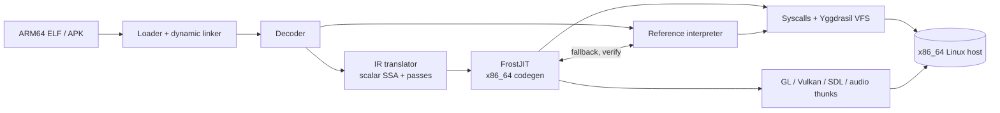

# bifrost-emu

```
  ____ _____ ______ _____   ____   _____ _______
 |  _ \_   _|  ____|  __ \ / __ \ / ____|__   __|
 | |_) || | | |__  | |__) | |  | | (___    | |
 |  _ < | | |  __| |  _  /| |  | |\___ \   | |
 | |_) || |_| |    | | \ \| |__| |____) |  | |
 |____/_____|_|    |_|  \_\\____/|_____/   |_|

  bifrost-emu  v2.0.0-beta.1
  x86_64 ◄─────────────────► ARM64
```

**A bridge between worlds.** Run ARM64 (AArch64) Linux programs, games and
Android apps on an x86_64 Linux PC, translated on the fly by a JIT compiler.
Existing binaries need no cross-compiler and no QEMU.

**Website:** [sloppyman2567.github.io/bifrost-emu](https://sloppyman2567.github.io/bifrost-emu/): what runs, screenshots
and how to install.

[](https://github.com/sloppyman2567/bifrost-emu/actions/workflows/ci.yml)
[](http://unlicense.org/)
[](https://isocpp.org/)
[](Docs/SUPPORT.md)
[](Docs/CHANGELOG.md)
[](#what-runs)

---

## Highlights

- **FrostJIT** — ARM64 → typed IR → scalar SSA → x86_64, with block chaining,
  an indirect-branch cache and an optional Tier-2 superblock compiler.
  A switch-based reference interpreter backs every instruction.
- **Checked against references** — instruction semantics (NaNs, rounding,
  signed zero, Q=0 lanes, faults) are compared with QEMU and the Arm pseudocode;
  `make verify` replays JIT blocks against the interpreter.
- **Android apps without a phone** — *Asgard* runs real Bionic, ART and the
  Android 15 framework with a shared Binder broker, installs signed APK sets
  (`bifrost-emu game.apk` installs and runs one) and runs games built with Unity/IL2CPP,
  Cocos2d-x and Ren'Py (see [What runs](#what-runs)).
- **Your real GPU, audio and input** — GL, EGL, GLES, Vulkan, SDL2/SDL3, ALSA
  and PulseAudio calls are forwarded to host libraries; Android windows render
  at the monitor's native pixel density.
- **A Linux personality** — 200+ syscalls, threads, signals, futexes,
  userfaultfd, cooperative `ptrace`, and a virtual `/proc`, `/dev` and `/sys`
  (*Yggdrasil* VFS). Dynamic programs find an [installed rootfs](Docs/ROOTFS.md)
  without flags.
- **Embeddable** — a C API (`libbifrost`) and an Android native-bridge
  adapter; see [embedding](Docs/EMBEDDING.md).

## What runs

**19 games recorded (2026-11-08): 16 playable** (12 Android, 4 Linux), **1 starts** without confirmed gameplay
(Teeworlds) and **2 are blocked** (Roblox, TrickCal). Umamusume counts as playable through its
Global client; its JP client is blocked. Apps such as YouTube and Firefox are not counted.

Statuses come from the linked pages and `Scripts/Android/compatibility.json`;
"user-confirmed" and "user-reported" mean the user played it on Bifrost, not
that every feature has an automated test or a recorded capture.

| Program | Kind | Status |
|---|---|---|
| [SpongeBob – Krusty Cook-Off 5.12.0](Docs/Apps/spongebob.md) | Android, Unity/IL2CPP | User-confirmed cooking levels, reaching level 16 at about 60 FPS (2026-11-01), outfits and menus at native resolution. Child-age path; the adult path waits on Google Play services. |
| [Azur Lane 9.3.7](Docs/Apps/azur-lane.md) | Android, Unity/IL2CPP | User-reported playable online through a finished battle, with audio and pause/resume (2026-11-01). Home screen captured at 60 FPS. |
| [Arknights 37.7.41](Docs/Apps/arknights.md) | Android, Unity/IL2CPP | User-reported playable: microG sign-in and a battle at about 60 FPS (2026-11-03). |
| The Battle Cats 15.6.1 | Android | User-reported playable (2026-10-29). |
| [Umamusume: Pretty Derby](Docs/Apps/umamusume.md) | Android, Unity | Global 1.35.2: user-reported playable, title, home and Career story captured at 30 FPS, the game's own frame cap (2026-11-01). JP 2.32.0: blocked by the game's device integrity check when it connects. |
| Subway Surfers 3.70.3 | Android, Unity/IL2CPP | User-reported playable, ads work (2026-10-29). |
| Geometry Dash Lite 2.2.148 | Android, Cocos2d-x | User-reported playable (2026-10-29); ads only somewhat stable. |
| Zenless Zone Zero 3.3.0 | Android, Unity/IL2CPP, Vulkan | User-confirmed gameplay in the city (2026-11-06), with very low-resolution textures and heavy lag (roughly 4 to 30 FPS on the overlay; the long loading screen is 0 to 2 FPS). Maximizing the window freezes its progress bar. |
| Doki Doki Literature Club 1.3.11.1 | Android, Ren'Py (SDL2, GLES) | User-confirmed play into the story (2026-11-06). The audio popped at every buffer boundary until the AAudio write path was fixed (user-confirmed clean 2026-11-08), and resizing the window blacks out images while text still draws (Ren'Py deletes its textures on an Android resize; the app opens with Window set to "Keep the app's shape", which avoids it, user-confirmed 2026-11-08). |
| Hungry Shark Evolution 14.5.0, Hungry Shark World 8.2.6 | Android | User-reported stable gameplay (2026-11-06). Hungry Shark World's Play Games sign-in does not complete. |
| YouTube 21.42.247 | Android | Home screen, search and video playback seen (2026-10-28); not reported as fully working. |
| [Oddmar](Docs/Apps/oddmar.md) | Android, Unity/IL2CPP | User-confirmed gameplay in the first level on 2.0.0-beta.1 (2026-11-08), with no stutter noticed; later levels are not confirmed. |
| Uptodown | Android | Draws its home list, then asks for all-files access, which Bifrost cannot grant. |
| Roblox, TrickCal | Android | Blocked: Roblox is disconnected after joining (needs real Google attestation); TrickCal's anti-cheat ends it. |
| [Neverball 1.6.0](Docs/Apps/neverball.md) | Linux, SDL2/GL | User-confirmed stable gameplay, replays, menus and fonts. |
| [Minecraft Weekend](Docs/Apps/minecraft-weekend.md) | Linux, SDL2/GL voxel game | User-confirmed stable gameplay; chunk rendering can lag. |
| [vkQuake 1.33.1](Docs/Apps/vkquake.md) | Linux, Vulkan | User-confirmed gameplay and menus. No texture corruption seen on LibreQuake data (2026-11-04); Quake's own data not retested. |
| [Doom 3 (dhewm3)](Docs/Apps/doom3.md) | Linux, SDL2/GL | User-reported extended gameplay with audio and animation; mostly sustained 60 FPS in the demo, even in heavy scenes (2026-11-01, not instrumented); the full game is not covered by that report. |
| Teeworlds | Linux, SDL2/GL | Reaches its rendering menu with sound initialized. |
| BusyBox, ToyBox | Linux CLI | Covered by the regression suite. |
| CoreMark | Linux benchmark | CRC-validated runs through `Scripts/Bench/run_benchmarks.py`. |

## Screenshots

User-supplied captures, not benchmarks. The Android shots are from 2.0.0-alpha.1 to 2.0.0-beta.1 (SpongeBob, Azur Lane
home and Umamusume November 1, Arknights November 3, Oddmar November 8, Azur Lane's login screen October 14); the Linux games are
from October 2 to 4. More are in the
[SpongeBob gallery](Docs/Apps/spongebob.md#screenshots-2026-11-01),
[Azur Lane gallery](Docs/Apps/azur-lane.md#screenshots-2026-10-14) and
[Umamusume gallery](Docs/Apps/umamusume.md#screenshots-2026-11-01).

<table>
<tr>
<td><br><sub>SpongeBob: Krusty Cook-Off (Android)</sub></td>
<td><br><sub>Azur Lane title/login (Android)</sub></td>
<td><br><sub>Neverball (Linux, SDL2/GL)</sub></td>
</tr>
<tr>
<td><br><sub>Minecraft Weekend (Linux)</sub></td>
<td><br><sub>Doom 3 / dhewm3 (Linux)</sub></td>
<td><br><sub>vkQuake (Linux, Vulkan)</sub></td>
</tr>
<tr>
<td><br><sub>Oddmar, a cave level (Android)</sub></td>
<td><br><sub>Arknights opening story (Android)</sub></td>
<td><br><sub>Umamusume: Pretty Derby home (Android)</sub></td>
</tr>
<tr>
<td><br><sub>Azur Lane home screen (Android)</sub></td>
<td><br><sub>SpongeBob: Krusty Cook-Off lobby (Android)</sub></td>
<td><br><sub>Doom 3 security checkpoint (Linux)</sub></td>
</tr>
<tr>
<td><br><sub>Oddmar, a harbour level (Android)</sub></td>
<td><br><sub>Minecraft Weekend at night (Linux)</sub></td>
<td><br><sub>Neverball new record (Linux, SDL2/GL)</sub></td>
</tr>
</table>

## Progress

**2.0.0-beta.1** (2026-11-03) is the current pre-release, and the work after it is in the tree and listed below. The goals
for it and what follows are in the [roadmap](Docs/roadmap.md), which has a
progress table and the known blockers; everything that changed is in the
[changelog](Docs/CHANGELOG.md). Since 2.0.0-alpha.2:

- **Install and run:** `bifrost-emu app.apk` installs and runs an Android
  package, a Debian/Ubuntu package and `asgard-setup` install Bifrost and Asgard,
  and an installable rootfs lets dynamic programs run without flags.
- **Linux personality:** guest `ptrace` and pseudo terminals, `/proc/<pid>/status`,
  and fork/exec fixes (fork children no longer hang or copy the game).
- **JIT:** 18-19% fewer generated bytes per guest instruction in the measured
  programs (guarded memory accesses), less multithreaded overhead, native pixel/media NEON forms, and an experimental,
  off-by-default persistent translation cache.
- **Android and graphics:** more service contracts (display, audio, Binder),
  fewer platform errors every game logged, and graphics-thunk fixes for pointer
  and string-array arguments.
- **Window stats:** an in-window overlay (`--window-stats`) for Android apps.
- **Android apps (beta.1):** a Vulkan device through a guest HAL over the host
  thunk, an app Keystore (PolyTrack saves) and real GPU fences for WebView; Zenless
  Zone Zero and Doki Doki Literature Club are recorded as playable.
- **Game windows (after the beta.1 label, in the tree):** a window the desktop minimises or hides pauses the app and resumes it
  when shown, F11 toggles fullscreen, the window's size is remembered per app, and an Activity that does not handle a resize
  is relaunched as Android does. Checked with fakes and fixtures, not yet on a real compositor or in a game.
- **Library and install (in the tree):** the library offers **Set up…** for what a checkout still lacks, packages up to 4 GiB
  install, a realm with no app ends after 10 minutes, built-in per-app settings let Doki Doki Literature Club open with its
  window mode that avoids a resize corruption, and an AAudio write fix removed clicks in its music.
- **JIT (in the tree):** native NEON `LD2` to `LD4` and `ST2` to `ST4`, FP compares kept in the host flags, and scalar FP
  special cases moved out of the hot path.
- **Open:** measured frame times, WebView interaction, window behaviour on real compositors,
  and sustained play. A passing build or a launch is not gameplay.

Check an installed app's recorded status yourself with
`python3 Scripts/Android/asgard.py compat`.

## Quick start

From a fresh clone, one command does everything: it installs the host packages (apt, dnf, zypper or pacman; it asks for
`sudo` only if some are missing), builds the emulator, then downloads and installs Asgard, all under `~/.local`:

```bash
git clone https://github.com/sloppyman2567/bifrost-emu && cd bifrost-emu
make bootstrap                         # about 1.5 GB of pinned downloads; PREFIX=DIR to install elsewhere
```

`make bootstrap` and `make deps` need `make`, and bootstrap also needs Python. On a minimal system without them, run
`Scripts/Setup/install-deps.sh` first: it needs only bash and installs both.

Nothing here needs root for what is already installed. A tool that is present but not on your `PATH` is found anyway
(`debugfs` lives in `/usr/sbin`, which an ordinary Debian user's `PATH` lacks; JDKs under `/usr/lib/jvm`, LLVM, `~/.local/bin`,
Nix and Homebrew are searched too, and `BIFROST_TOOL_DIRS=DIR` adds a directory), and a library `pkg-config` finds is not
installed again. Where the distribution has no SDL3 (Debian 12 and 13, Ubuntu 24.04), bootstrap installs what building it
needs and builds SDL 3.4.18 from the pinned release into `Tools/sdl3`; it installs it beside the emulator
(`PREFIX/lib/bifrost`). An interrupted download (Ctrl-C included) is kept as `NAME.part` and the next run resumes it.

This is new and not yet confirmed end to end, and `make deps` has only been shown to work on some distributions: see the
[support matrix](Docs/SUPPORT.md). If Bifrost is already installed elsewhere, such as `/usr/local`, this makes a second copy of
about 1.1 GB, which takes over if `~/.local/bin` comes first on your `PATH`. To update an existing install instead, see
[the APK guide](Docs/Android/ANDROID_APK.md).

To build only the emulator:

```bash
make deps                              # once: the host packages
make -j$(nproc)                        # build (SDL2/GL thunks auto-detected)
./bifrost-emu hello.elf                # run a static ARM64 binary
./bifrost-emu -v Tests/Apps/fib.elf    # print execution stats on exit
./bifrost-emu Tests/Apps/toybox seq 1 10   # arguments pass through
```

On an immutable Fedora such as Bazzite, do it inside a [Distrobox](https://distrobox.it) container, and run the emulator
there too, since it links the container's libraries:

```bash
distrobox create --name bifrost --image registry.fedoraproject.org/fedora-toolbox:44 && distrobox enter bifrost   # Bazzite only
make deps
make -j$(nproc)
./bifrost-emu --setup-rootfs                  # once: the libraries Linux programs need
./bifrost-emu --setup-rootfs --games          # for Linux games; --rootfs-default games then uses them by default
```

Checked in a Fedora 44 chroot on one machine, without Distrobox, a display or a GPU: see the [support matrix](Docs/SUPPORT.md).

On Debian and Ubuntu (25.10 or newer for Android windows) the quickest install is the package:

```bash
sudo apt install build-essential debhelper pkg-config libavcodec-dev libavutil-dev libswscale-dev \
     libegl-dev libffi-dev libgl-dev libsdl3-dev libsdl2-dev libwayland-dev libx11-dev
make deb                                  # writes ../bifrost-emu_2.0.0~beta.1_amd64.deb
sudo apt install ../bifrost-emu_*.deb
bifrost-emu --setup-rootfs                # once: downloads the toolchains and builds the guest rootfs
```

Android apps need Asgard, which `make deb` also packages as `bifrost-emu-asgard`:

```bash
sudo apt install ../bifrost-emu-asgard_*.deb      # also pulls in clang, lld and a headless JDK
asgard-setup                                      # once: ~1.5 GB of pinned downloads, then installs ~1.1 GB under ~/.local
bifrost-emu /path/to/app.apkm                     # installs and runs it
```

Dynamically linked programs need a guest root filesystem for their libraries.
Install a standard one, then run programs directly ([details](Docs/ROOTFS.md)):

```bash
./bifrost-emu --setup-rootfs           # for your user, ~/.local/share/bifrost/rootfs (~235 MB download)
sudo make install install-rootfs       # or system-wide, under $(PREFIX)/share/bifrost
bifrost-emu my_dynamic_app.elf         # finds the rootfs automatically
```

`--setup-rootfs` runs the checkout's `Scripts/Setup/install-rootfs.sh` and passes its options on: `--system`,
`--prefix DIR`, `--full` (more real-world libraries), `--profile NAME`, `--games` and `--uninstall`.

Linux games need more libraries than the base rootfs; Android apps use neither, because Asgard brings its own. `--setup-rootfs --games` downloads OpenAL, SDL2_ttf, Vorbis, libpng,
libjpeg, libcurl and their dependencies into a `games` profile; `--rootfs-profile games` selects it and `--rootfs-list`
shows what is installed. Without any flag, the first rootfs found next to the executable, in the user's data directory
or system-wide supplies the libraries, like `qemu-aarch64 -L`, and the guest still sees host paths; `--rootfs PATH`
(or `BIFROST_ROOT`) instead makes PATH the guest's root. The full search order is in the [rootfs guide](Docs/ROOTFS.md).
`./Scripts/Setup/setup-rootfs-all.sh` builds the development `rootfs/` that the test suite uses.

Android apps install from a signed APK, APKM or APKS bundle:

```bash
./bifrost-emu /path/to/game.apkm      # installs if needed, then runs (.apk/.apkm/.apks/.xapk)
python3 Scripts/Android/android_package.py run org.example.game   # an installed package id
```

This needs Asgard. From a fresh clone, one command downloads and builds what it needs (about 1.5 GB of pinned
downloads) and installs it so it works from any directory:

```bash
make provision-asgard PREFIX=$HOME/.local      # for your user; add ~/.local/bin to PATH for the asgard command
make android-provision && sudo make install-asgard   # or system-wide: /usr/local needs sudo
```

The desktop launcher (`asgard launcher`) also needs PyQt6, which `make deps` and `make bootstrap` install;
`bifrost-emu app.apk` works without it. Run the command again after an update: only the files that changed are copied. `./Scripts/Setup/install-asgard.py` is the
install step alone, for a checkout that is already provisioned; the [APK guide](Docs/Android/ANDROID_APK.md) has the details.

`--guest-ld` (experimental, not the default) runs dynamic programs under the rootfs's own `ld.so`, as a kernel exec
would, instead of the built-in linker. It needs the `ld.so.cache` that the rootfs setup writes. Thunked libraries (GL,
SDL2, Vulkan, audio) are served to it as in-memory stubs, and it works with an automatically found rootfs as well as
with `--rootfs`. It passes the same test suites as the built-in linker; dhewm3 (120 s) and neverball ran under it, but
other games and `make verify` have not been run with it.

Useful switches: `-d` traces every instruction, `--no-jit` forces the
interpreter, `--window-stats` shows FPS and load statistics in the title and, for Android
apps, an in-window overlay (see [window stats](Docs/window-stats.md); `--window-stats-mode`
picks the layout), `BIFROST_TIER2=1` enables experimental Tier-2 region compilation, and the
experimental `--jit-disk-cache` keeps translations in `~/.cache/bifrost/jit` so later launches start
faster (the first launch compiles more slowly; see [the JIT guide](Docs/JIT.md#persistent-translation-cache-2026-10-26-experimental-off-by-default)).

## Running programs

### Static binaries

Static AArch64 ELF binaries work out of the box. This covers most
cross-compiled Go, Rust, C and C++ programs, static BusyBox and ToyBox, and
game engines that ship statically linked.

### Dynamically linked binaries

Both **glibc** (2.36 through 2.40+, including DT_RELR) and **musl** guests are
supported, with shared libraries, GOT/PLT relocation, TLS, ifuncs, versioned
symbols and constructors. glibc's NPTL threads, mutexes, condition variables
and `__thread` TLS work end to end across multiple thread waves. The rootfs
setup can also be done step by step:

```bash
./Tools/Fetch/fetch-glibc-toolchain.sh     # glibc toolchain (130 MB)
./Tools/Fetch/fetch-musl-toolchain.sh      # musl toolchain (104 MB)
./Scripts/Setup/setup-rootfs.sh            # rootfs with glibc + musl libraries
./Scripts/Setup/fetch-realworld-libs.sh    # libselinux, libpcre2, libssl, ...
./Scripts/Setup/fetch-curl-deps.sh         # curl's 24 dependency libraries
```

The rootfs provides both dynamic loaders and libcs, `/etc` basics, timezone
data, and Android-style `/system`, `/data` and `/sdcard` scaffolding.

### Android apps (Asgard)

**Asgard** is Bifrost's Android compatibility layer. It boots a real guest
`linker64`, Bionic and ART, and supplies Android 15 framework services from a
managed launcher: Activities, windows and dialogs, input, audio, display,
package queries, JobScheduler and more. An app supervisor and shared Binder
broker connect an app's processes (game, WebView, services).

```bash
python3 Tools/Android/fetch-android-runtime.py         # one-time runtime setup
python3 Tools/Android/fetch-aapt2.py
python3 Tools/Android/fetch-android-package-tools.py
make android-runtime-adapters android-managed-launcher
python3 Scripts/Android/android_package.py install /path/to/package.apkm
python3 Scripts/Android/android_package.py run org.example.package
python3 Scripts/Android/asgard.py run /path/to/package.apkm   # installs, then runs (or run an installed app by package id, or part of its name)
python3 Scripts/Android/asgard.py realm status        # inspect the shared realm
python3 Scripts/Android/asgard.py config org.example.package network offline   # per-app settings, applied at every start
python3 Scripts/Android/asgard.py clear-data org.example.package   # reset saves; `uninstall` removes the app
python3 Scripts/Android/asgard.py launcher             # the desktop app library: install, play, settings, last session; a gamepad drives it too (--fullscreen)
python3 Scripts/Android/asgard.py google sign-in       # experimental: microG's Google sign-in window (accounts shared by every app)
```

Per-app settings (Back and Enter keys, Window, Controller, network, stats and more) are in the library's settings dialog and in the
[APK guide's table](Docs/Android/ANDROID_APK.md#per-app-settings). A gamepad drives the library and, with the Controller
setting, a touch cursor for apps that only take touch.

In a game window, **F11** toggles fullscreen and the size is remembered per app. A window the desktop minimises or hides stops the
app until it is shown again (X11 reports minimising; on Wayland it depends on the compositor suspending the window). The library
offers **Set up…** when a checkout lacks something, and a realm with no app ends after 10 minutes
(`ASGARD_REALM_IDLE_SECONDS`, `0` keeps it). See [window visibility](Docs/Android/ANDROID_RUNTIME.md#window-visibility-2026-11-07).

Native `NativeActivity` libraries can also run directly with
`./bifrost-emu --android libgame.so`. Android support is experimental: Google
Play services come from microG (sign-in works up to Google's own page; see the
runtime guide), media decoding and many system services are partial or missing. See
the [Android runtime guide](Docs/Android/ANDROID_RUNTIME.md),
[APK tooling](Docs/Android/ANDROID_APK.md),
[Binder](Docs/Android/ANDROID_BINDER.md) and
[window plugins](Docs/Android/ANDROID_WINDOW_PLUGINS.md).

## Architecture



| Component | Location | Role |
|---|---|---|
| ELF loader | `Source/System/Loader/ElfLoader.cpp` | Static and PIE binaries, RELA relocations |
| Dynamic linker | `Source/System/Loader/DynamicLinker/` | DT_NEEDED, GOT/PLT, TLS, ifuncs, versioned symbols |
| Decoder | `Source/Interpreter/Decoder/` | Shared AArch64 decoder for both engines |
| IR translator | `Source/FrostJIT/IR/` | Typed IR, scalar SSA, optimization and validation |
| FrostJIT | `Source/FrostJIT/` | x86_64 code generation, register allocation, dispatch, Tier-2 |
| Interpreter | `Source/Interpreter/` | Reference semantics and JIT fallback |
| Syscalls | `Source/System/Syscalls/` | 200+ Linux AArch64 syscalls by family |
| Yggdrasil VFS | `Source/System/VFS/` | Virtual `/proc`, `/dev`, `/sys`, framebuffer, audio, input |
| Threads/signals | `Source/System/Core/` | `clone`, futexes, signal delivery, shared JIT |
| Thunks | `Source/System/Graphics/`, `Source/System/Audio/` | Host GL/EGL/Vulkan/SDL/audio forwarding |
| Asgard | `Source/System/Android/`, `Guest/Android/` | Binder, surfaces, loopers, managed framework services |

The [source layout](Docs/ARCHITECTURE.md) and [JIT guide](Docs/JIT.md) go
deeper. Host forwarding and input are described in
[host integration](Docs/HOST_INTEGRATION.md).

## Building

| Requirement | Needed for |
|---|---|
| g++ 9+ (C++17), make, Linux x86_64 | Everything (required) |
| x86-64 CPU with SSE4.1 and FMA3 | The JIT (`--no-jit` runs on any x86-64 CPU, much more slowly) |
| SDL2 development headers (`./Tools/Fetch/fetch-sdl2-headers.sh`) | Framebuffer, guest SDL2 and GL thunks |
| SDL3 ≥ 3.2 headers and runtime | Android host windows |
| FFmpeg libavcodec/libavutil/libswscale development files | Android host media decoding (`USE_MEDIA=1`, default) |
| AArch64 cross toolchain (`./Tools/Fetch/fetch-musl-toolchain.sh`) | Building guest test programs |

`make deps` installs all of these except the cross toolchain, using apt, dnf, zypper or pacman
([what has been checked](Docs/SUPPORT.md)).

| Command | Builds |
|---|---|
| `make bootstrap` | Host packages, the emulator and Asgard, installed under `~/.local` or `PREFIX` |
| `make` | Default; auto-detects SDL2 and enables host GL/EGL thunking |
| `make USE_SDL2=1 USE_SDL3=1 USE_THUNK_GL=1` | Android SDL3 windows plus guest SDL2/GL thunks |
| `make USE_SDL2=0 USE_SDL3=0` | Headless build |
| `make USE_MEDIA=0` | No host media decoders; Codec2 advertises no host codecs |
| `make debug` | Sanitizer build at `build/debug/bifrost-emu-dbg` |
| `make lib` | `libbifrost.a` for [embedding](Docs/EMBEDDING.md) |

Each configuration gets its own `build/release-sdl*-gl*` directory; the default
release binary is also copied to `./bifrost-emu`. `make clean` removes them all.
Guest test programs build with `make setup-tests`, or one at a time with
`make cross SRC=Tests/Apps/my_test.c OUT=Tests/Apps/my_test.elf`.

## Testing

```bash
make check            # standard suite (benchmarks included)
make check-quick      # without benchmarks
make check-nojit      # quick suite under the interpreter
make verify           # replay JIT blocks against the interpreter
make ci               # local correctness gate (generated files, APIs, both engines)
./Scripts/Testing/run_tests.sh --strict --filter "sig|brk|pipe"   # by name
```

On 2026-11-01, with every fixture provisioned, the strict suite passed
**377/377** under the JIT and **362/362** under the interpreter (15 JIT-only
tests are not run there), and `make verify` passed 100 differential fixtures plus
ten threaded oracle runs. Missing fixtures fail strict mode; environment skips
(exit 77) stay visible. Details, history and fixture licensing are in
[test evidence](Docs/TESTS.md) and [third-party notes](Docs/THIRD_PARTY.md).

## Configuration

Settings come from a TOML file, environment variables and flags:

```bash
./bifrost-emu --config bifrost.toml my_app.elf   # use a config file
./bifrost-emu --print-config                     # show effective settings

BIFROST_ROOT=/path/to/rootfs    # guest root filesystem
BIFROST_TIER2=1                 # experimental Tier-2 region compilation
BIFROST_JIT_VERIFY=1            # JIT vs interpreter divergence check
BIFROST_SYSCALL_TRACE=1         # trace syscalls
BIFROST_DYNLINK_TRACE=1         # trace the dynamic linker
BIFROST_THUNK_TRACE=1           # trace host GL/audio/display calls
```

[`bifrost.toml.sample`](bifrost.toml.sample) lists every option;
`Source/System/Core/DebugFlags.hpp` lists the diagnostic switches.

## Performance

CoreMark (November 8, 2026), measured on a Ryzen 7 5800X3D with the CPU governor on `performance` (boost on): 160,000
iterations, one warmup and three interleaved measured runs per binary, every CRC validated (`crcfinal` 0xa14c, the same value
QEMU reports) and no CoreMark validity error. The bifrost-emu builds come from `git archive` of the tree at `ecbd7dd1` and of
the 2.0.0-alpha.2 release commit. At this count the current build runs about 10.8 s, just over CoreMark's ten-second minimum,
so a build faster than about 16,000 iterations/s needs a higher count. See [the method and
limits](Docs/JIT.md#coremark-re-measurement-2026-11-08).

| Build | Median iterations/s |
|---|---|
| bifrost-emu 2.0.0-beta.1 tree (JIT, shipped SDL/GL build) | 14,874 |
| same code, headless build | 14,753 |
| bifrost-emu 2.0.0-alpha.2 (JIT, headless build) | 12,711 |
| QEMU 11.1.1 user mode (TCG) | 7,992 |

On this integer/control-flow benchmark the shipped build is about 86% faster than
QEMU, and the headless build of the same code is about 16% faster than the
alpha.2 release built the same way. Neither predicts game FPS. The runs spread 1% to 2.5%
(QEMU's 7,981 to 8,065) on a desktop with a QEMU virtual machine and an idle Asgard realm running, so differences of a
few percent are within noise; the alpha.2 binary itself measured 3% higher than in the October 27 session, so compare
numbers within one table, not across dates. Measurements from the `bench_*` programs
(same host, median of three runs; each program's own timer, except `bench_mips`,
which is process wall time; JIT compilation is included, so the millisecond-scale
JIT times are coarse):

| Benchmark | Interpreter | JIT | Speedup |
|---|---|---|---|
| fib(35) | 7.35 s | 0.076 s | ~97x |
| memcpy 256 MiB | 171 MiB/s | ~9,390 MiB/s | ~55x |
| qsort 100K ints | 4.51 s | 0.076 s | ~59x |
| matrix 256×256 | 11.9 MFLOPS | ~1,129 MFLOPS | ~95x |
| bench_mips (800M instructions) | ~51 MIPS | ~4,515 MIPS | ~89x |

Repeatable runs with checksums and host metadata: `Scripts/Bench/run_benchmarks.py`.
The JIT uses AVX-512, AVX2, SSE4.2, AES-NI/PCLMULQDQ/SHA-NI, BMI1/BMI2 and
FMA3 where the host has them, with fallbacks. Game profiling notes live
on each app page, for example [Doom 3](Docs/Apps/doom3.md).

## Embedding

```c
#include "Bifrost.h"

bifrost_emu_t* emu = bifrost_create();
bifrost_load_elf(emu, "hello.elf", argc, argv);
int exit_code = bifrost_run(emu);   // JIT on by default
bifrost_destroy(emu);
```

The C API also offers register and memory access, stepping with breakpoints,
guest function calls, symbol lookup, syscall hooks and guest `dlopen`. The
[embedding guide](Docs/EMBEDDING.md) covers it and the Android native-bridge
adapter.

## Limitations

- **User mode only** — no kernel or full-system emulation (use QEMU system mode).
- **AArch64 guests only** — no 32-bit ARM, so an Android APK that ships only
  `armeabi-v7a` or `x86` libraries cannot start.
- **x86_64 Linux hosts only** — other distributions are expected to work but
  only Ubuntu 24.04 is CI-built; see the [support matrix](Docs/SUPPORT.md).
- **Android is experimental** — Google Play services and complete system_server
  remain absent. Small Codec2 decoding/Surface probes pass; full in-game video
  and rewarded-ad playback are unverified. Window behaviour (minimise, fullscreen, remembered size) has been checked with fakes,
  not on every compositor.
- **Untrusted binaries** — read the [security model](Docs/SECURITY.md) first.

## Documentation

The current version is **2.0.0-beta.1**, the first beta pre-release toward the
[v2.0 roadmap](Docs/roadmap.md); its goals are not complete yet.

| Topic | Document |
|---|---|
| App status | [SpongeBob](Docs/Apps/spongebob.md), [Azur Lane](Docs/Apps/azur-lane.md), [Arknights](Docs/Apps/arknights.md), [Oddmar](Docs/Apps/oddmar.md), [Umamusume](Docs/Apps/umamusume.md), [Neverball](Docs/Apps/neverball.md), [Minecraft Weekend](Docs/Apps/minecraft-weekend.md), [vkQuake](Docs/Apps/vkquake.md), [Doom 3](Docs/Apps/doom3.md), [zstd](Docs/Apps/zstd.md) |
| JIT internals | [JIT guide](Docs/JIT.md) |
| Source layout | [Architecture](Docs/ARCHITECTURE.md) |
| Android | [Runtime](Docs/Android/ANDROID_RUNTIME.md), [APKs](Docs/Android/ANDROID_APK.md), [Binder](Docs/Android/ANDROID_BINDER.md), [window plugins](Docs/Android/ANDROID_WINDOW_PLUGINS.md) |
| Host graphics, audio and input | [Host integration](Docs/HOST_INTEGRATION.md), [window stats](Docs/window-stats.md) |
| Embedding | [C API and native bridge](Docs/EMBEDDING.md) |
| Support and security | [Support matrix](Docs/SUPPORT.md), [security model](Docs/SECURITY.md) |
| Tests and history | [Test guide](Docs/TESTS.md), [changelog](Docs/CHANGELOG.md) (releases before 2.0.0-alpha.3 are in `Docs/archive/`), and the dated [test](Docs/archive/TESTS-history.md), [JIT](Docs/archive/JIT-history.md) and [runtime](Docs/archive/ANDROID_RUNTIME-history.md) history, [third-party notes](Docs/THIRD_PARTY.md); per-app investigation logs are in `Docs/archive/apps/` |
| Licensing | [License scope and texts](LICENSES/README.md) |
| Configuration | [`bifrost.toml.sample`](bifrost.toml.sample) |

## License

Bifrost's original code, original Asgard integration and original regression
tests use the [Unlicense](LICENSE). Reused AOSP material keeps its upstream
license; [LICENSES/](LICENSES/README.md) includes Apache 2.0 and Android source
attribution alongside the project license. Third-party fixtures, vendored
dependencies and game assets keep their own terms. See
[third-party and test distribution notes](Docs/THIRD_PARTY.md).

## Contributing

1. Fork the repository and follow the existing code style.
2. Build guest fixtures with `make setup-tests`, then run the relevant JIT and
   interpreter checks (`make check-all` for provisioned coverage).
3. For JIT changes, read the [JIT guide](Docs/JIT.md) and run `make verify`;
   report existing verifier failures separately from new ones.
4. Preserve upstream notices for reused code and include validation evidence
   with your pull request. Original contributions, including tests, use the
   Unlicense; reused code retains its upstream license and attribution.

Bug reports help most with the AArch64 binary (or a minimal reproducer), the
exact command line, and the tail of `./bifrost-emu -v -d ... 2>&1`.
