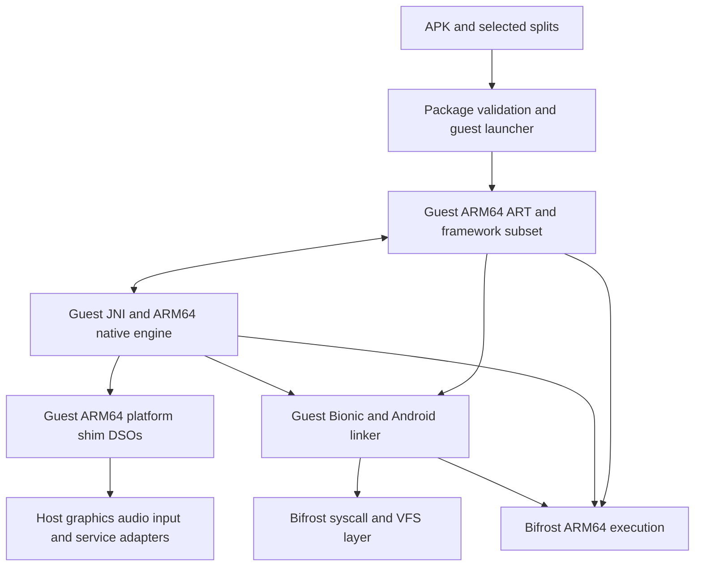

# Android APK execution architecture

Status: runtime foundations implemented, October 5, 2026. Real Bionic native
bootstrap, signed native APK loading, a bounded native service manager and an
injectable native window backend are available. ART/framework execution is
not implemented. Reproduction
and limits are in [ANDROID_RUNTIME.md](ANDROID_RUNTIME.md),
[ANDROID_APK.md](ANDROID_APK.md), [ANDROID_BINDER.md](ANDROID_BINDER.md) and
[ANDROID_WINDOW_PLUGINS.md](ANDROID_WINDOW_PLUGINS.md).

## Proposed runtime boundary

Run a matching ARM64 Android linker, Bionic, ART and managed libraries inside
the guest. Bifrost translates their ARM64 instructions and supplies Linux
syscalls plus explicit Android platform adapters. JNI calls, Java objects,
exceptions and GC references stay within the guest ABI.

Use Android 15 / API 35, ARM64, with a 4 KiB page configuration as the initial
candidate baseline. Pin an exact AOSP revision and build configuration before
integrating ART. Linker, Bionic, ART, libcore, boot images and framework jars
must come from that same build, with recorded hashes and licenses. The API
level becomes advertised compatibility only after its acceptance gates pass.

Build modern guest components with at least 16 KiB ELF alignment and discover
the runtime page size through auxv/Bionic. ELF alignment does not require an
equal runtime granule: AOSP explicitly supports 16 KiB-aligned binaries on
both 4 KiB and 16 KiB kernels ([page-size reference](https://source.android.com/docs/core/architecture/16kb-page-size/16kb)).
The initial Bifrost runtime uses 4 KiB pages; full 16 KiB runtime semantics
would require separate mmap/protection/auxv work. Do not merely change
`AT_PAGESZ` to 16384. The supplied game's 21 ARM64 libraries are 16 KiB-aligned.

Android 15 corresponds to API 35 ([SDK reference](https://developer.android.com/about/versions/15/setup-sdk)).
ART executes DEX and provides managed GC and compiled execution
([AOSP runtime reference](https://source.android.com/docs/core/runtime)).
Keeping it in the guest avoids introducing a second JNI/object ABI boundary;
this is an architectural recommendation, not a measured performance result.

## What exists and what must change

The current `--android libgame.so` path constructs a synthetic NativeActivity
and loads its library through Bifrost's custom DynamicLinker. It is useful for
native adapter tests; it does not initialize a complete Android runtime.

The explicit `--android-runtime --rootfs PATH /guest/program` profile resolves
`/system/bin/linker64` inside the guest root, validates and maps its ELF through
the checked loader, and enters it with the guest stack and auxv. The guest
linker owns relocation and Bionic TLS. The bootstrap exercises constructors,
thread-local storage, pthreads and dlopen; it does not establish ART startup or
complete Android linker namespace compatibility. The existing Linux custom
linker path remains available for Linux programs and native adapter fixtures.

The package tool validates signatures and a consistent base/split set, then
publishes immutable code plus persistent per-app data. Its Bionic-linked guest
launcher opens the native entry library with actual `dlopen`; platform shim
DSOs resolve explicit existing thunk exports. The signed NativeActivity fixture
passes real graphics, asset, storage, lifecycle, TLS and service-call checks.
It has no JavaVM/JNIEnv and cannot launch managed Activities.

Virtual `/dev/binder`, `/dev/hwbinder` and `/dev/vndbinder` provide bounded
transactions, replies and flat-object handle translation within one emulator.
The opt-in `--android-services` registry implements named native service
registration/discovery and callable handles using a bounded API-35 AIDL parcel
subset. Framework services, descriptor transfer and death subscriptions remain missing.
The native surface adapter delegates window binding and resize to an injectable
C++ backend, with a versioned host C ABI for loadable window modules. The SDL
backend passes native Wayland EGL pixel readback and presentation. Full Android
Surface/BufferQueue service integration remains work
for the platform layer.

The existing native-bridge adapter has scalar trampolines but no complete
host-ART/guest-JNI object bridge or namespace implementation. Preserve it for
its current callers; it is not the foundation of this guest-ART design.

## Component contracts

- **Android runtime profile:** separate runtime root, API/build identity,
  properties, library paths and capability list. Select it explicitly; keep
  existing Linux loading behavior. Native fixtures use `--android-runtime
  --rootfs PATH /guest/program`; signed native-only APKs use the package launcher. Retain
  the current bare-library command for adapter testing.
- **Package installation:** inspect manifests, select compatible ARM64 and
  resource splits, validate package/version/signing consistency, and publish
  an installation atomically. Keep package code read-only and data/cache
  directories separate. Bound ZIP processing and reject unsafe paths. The
  package tool implements consistent-set installation; resource configuration
  selection remains future work. The separate read-only preflight tool is reconnaissance.
- **Guest linker:** own relocations, dlopen, TLS and namespace decisions.
  Supply deliberate namespace configuration and guest shim DSOs; never fall
  through to host x86 ELF libraries. Namespace isolation is a genuine loader
  contract ([AOSP documentation](https://source.android.com/docs/core/architecture/vndk/linker-namespace)).
- **Platform shims:** ARM64 DSOs expose the Android ABI and invoke the existing
  thunk dispatcher. Use the shared trampoline writer. Marshal structures and
  callbacks explicitly; translate opaque handles with owned handle tables.
  Reuse host graphics/audio backends after auditing Android API coverage.
- **Guest threads and memory:** preserve Bionic TLS, futex, signal and thread
  teardown semantics. ART suspension, GC faults and safepoints must work through
  real guest signal delivery. Maintain correct protection changes, executable
  page invalidation and code retirement under concurrent execution. Keep ART
  code caches distinct from Bifrost's translation caches.
- **Framework and services:** execute matching framework code where practical,
  and implement selected platform service contracts behind explicit adapters.
  Define Binder object identity, parcels, calling identity, death notification
  and thread dispatch before exposing service APIs. Missing functionality must
  produce actionable errors, not successful no-ops. A single-app launch can
  precede full zygote/system_server support, but still requires validated
  framework initialization and Activity lifecycle behavior.
- **App isolation:** use a dedicated emulator process and per-app VFS/data root.
  Route paths and granted capabilities through that root. This is an execution
  layout, not a security sandbox guarantee; do not execute untrusted packages
  without a separately validated host containment boundary.

## Implementation sequence and acceptance gates

1. **Bionic bootstrap.** Build the pinned runtime fixture set and explicit
   Android profile. Run a dynamically linked ARM64 hello-world through the
   actual linker64. Then verify TLS across threads, dlopen and constructor order,
   namespaces, futex waits, signals, mmap/mprotect and orderly thread shutdown.
   Gate: pass in interpreter and default JIT modes; retain all Linux tests.
2. **Managed runtime.** Boot the smallest supported ART/libcore environment,
   initially with DEX interpretation and ART JIT disabled. A DEX fixture loads
   an ARM64 JNI library, receives native-to-Java callbacks, throws/catches
   exceptions and survives repeated GC with attached native threads.
   Gate: repeatable GC/suspension and reference-lifetime tests, no hangs or stale
   translations. Audit required runtime artifacts before committing to a full
   framework boot image or a reduced test image.
3. **Packaged application.** Install base APK plus validated required splits,
   read resources/assets, create app storage and launch a minimal Activity and
   then a packaged NativeActivity. Gate: rendering, input, audio, persistent
   saves, pause/resume and surface recreation work through guest-owned lifecycle.
4. **Selected Unity target.** Audit the supplied SpongeBob bundle's Java startup,
   SDK dependencies and service calls. Implement the measured required framework
   and service subset. Gate: its actual launcher reaches repeatable interactive
   gameplay with lifecycle and storage working. Startup may require services
   beyond the native engine's ELF dependencies; report these explicitly.
5. **Compiled ART and performance.** Enable ART JIT/AOT only after managed
   correctness passes. Exercise executable-page reuse, protection changes,
   cache maintenance and concurrent invalidation. Profile translated runtime,
   engine, syscall, service and host rendering costs separately. Evaluate Tier 2
   with matched workloads and frame times; keep it opt-in until Android evidence
   demonstrates correctness and a benefit.

Each milestone adds meaningful cross-compiled fixtures and repeatable host
integration checks. Do not treat a successful import, build or first frame as
completion of the next milestone. No APK compatibility percentage or deadline
is justified yet.

## Concrete target evidence

The locally inspected `com.tiltingpoint.spongebob` 5.11.5 bundle contains nine
APKs, eight DEX files and 21 ARM64 native libraries, including Unity and IL2CPP.
Its minimum SDK is 25 and target SDK is 35. Its launcher is
`com.clevertap.unity.CleverTapOverrideActivity`, so directly calling a
NativeActivity entry point cannot reproduce its startup. Its native imports
include `libEGL`, `libandroid`, `libmediandk`, Bionic and logging libraries.
IL2CPP does not remove the managed launcher/framework requirements.

Evidence: `bench-results/android-spongebob-preflight-2026-10-04.json`, produced
with the official pinned AAPT2 binary. The report records inventory and blockers,
not runtime compatibility. Network, account, proprietary services and media
requirements remain to be established by dependency analysis and execution.

## Next bounded task

The explicit bootstrap, signed native APK launcher, guest shim DSOs and native
service registry now work. The next managed-runtime gate requires obtaining
and auditing one matching ART/libcore artifact set, then executing a DEX-to-JNI
fixture with GC and thread attachment. The separate `tools/android_art.py`
provisioner now pins the API-35 ARM64 revision-2 image and its 309-file runtime
inventory. The real-ART launcher loads ART but its VM-creation probe encounters
unsupported UADALP; DEX/JNI execution has not passed. See
[the reproducible ART checkpoint](ANDROID_RUNTIME.md#experimental-same-image-art-bootstrap).
The next gate is resolving this measured instruction failure and completing VM
creation, followed by reference/GC/thread checks. Native lifecycle/resource coverage still
needs expansion beyond the documented subset. The bootstrap APEX is a
native test dependency, not a complete API 35 platform installation. Do not
modify the Tier-2 policy merely to make Android startup appear faster.
